# Changelog

What changed in each release of BlueprintReview (the app `blueprintreview-app` and the CLI `blueprintreview`). A release tag `vX.Y.Z` needs a `## [X.Y.Z] - date` section here: `.github/workflows/release.yml` takes the release notes from it (`scripts/release.py notes`), and the app's update check shows its first line.

Each section opens with `### Highlights`: the one to three changes that matter most to users, in plain words, with a screenshot where one helps (an indented `` line under the item). The full notes follow under `### Before you upgrade` (steps an upgrade needs), `### New`, `### Improved`, `### Fixed` and `### Plugin and CLI`, in that order, each heading only when it has entries: one plain sentence per change, then the detail a user needs (a command, a setting, a file). Write new entries under those headings in `[Unreleased]`, and the highlights before `release.py cut`, which refuses a section without them (`docs/RELEASING.md`).

## [Unreleased]

## [1.3.0] - 2026-11-23

### Highlights

- **Merge two branches of a Blueprint (experimental).** When `git merge` stops on a `.uasset`, the new merge view shows theirs, the merged result and ours side by side, takes every change only one branch made, and lets you choose for each conflict; *Apply merge* writes the result through Unreal.

  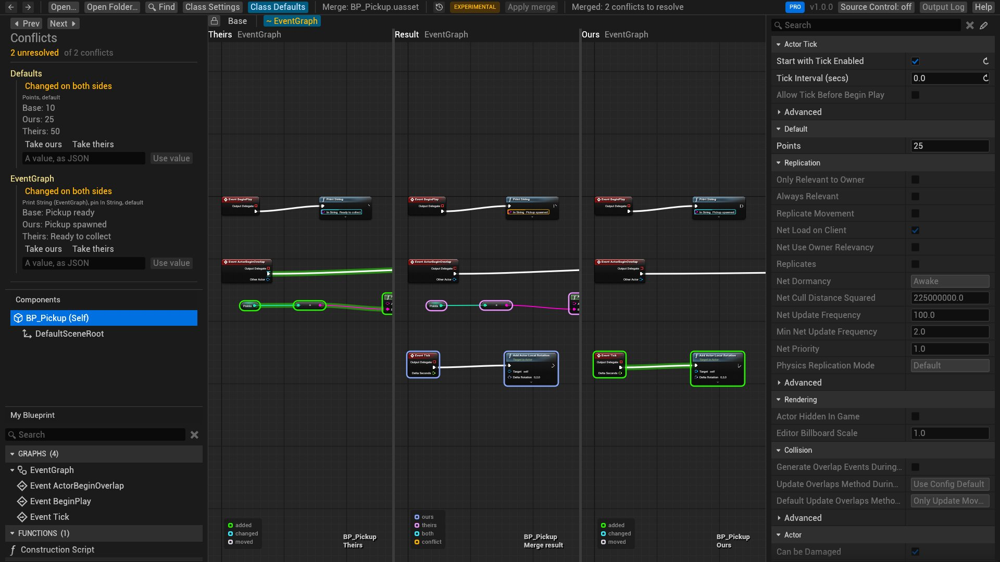

- **Buy Pro or Team on the website, or get BlueprintReview from the Microsoft Store.** The key appears on the thank-you page and arrives by email; the Store version is signed and keeps itself up to date.
- **The Unreal plugin tells you when the app is missing.** A diff started in the editor finds BlueprintReview wherever the installer or the Store put it; if it isn't installed, a notification offers the Microsoft Store. The plugin's settings are now one page, *Editor Preferences > Plugins > Blueprint Review*.

### New

- You can now buy BlueprintReview Pro and Team on the website: *Buy Pro* and *Buy Team* in the landing page's pricing section. The license key appears on the thank-you page and arrives by email.
- BlueprintReview is on the [Microsoft Store](https://apps.microsoft.com/detail/9N9W75PDPVWX): signed, so SmartScreen doesn't ask, and kept up to date by the Store. The landing page links to it.
- A merge view (experimental): `blueprintreview-app --merge BASE LOCAL REMOTE MERGED` shows both changed versions and the merged result side by side, lets you pick a side for each conflict, and writes the result with the plugin. Its toolbar says it's experimental: keep the project under source control and check the merged Blueprint before you commit it. Writing the result (*Apply merge*) needs UE 5.7 or 5.8 with the BlueprintReview plugin in the project. The merge view is part of Pro. The user guide's new page *Merge two branches* walks through it.
- Merge: you can undo a change the merge took from one branch. Each row of *N changes merged* has *Take ours* and *Take theirs*: taking the other branch's version leaves out a node it added, keeps an item it removed, or keeps the old value. *Clear* takes it back. In `blueprintreview merge --resolve`, a change's path takes `ours` or `theirs` the same way.

### Improved

- The merge view has a legend in the corner of each graph: what the outlines on Theirs, Ours and Base mean (added, changed, moved, removed: what that branch did, not a conflict) and on the Result (ours, theirs, both, conflict). Point at a line for more.
- Merge: the changes merged and the merge's warnings read in words, as the diff's changes do, in the merge view and the `blueprintreview merge` report: "BoostTime: default 0.0 → 2.0", "Added Delay to EventGraph", "Bob timeline: track Pulse added", where they used to show internal paths such as `variables[24F0…].type`. Values read as the Details panel shows them (`2.0`, not `2.000000`). In the merge view a conflict says what it is about the same way, and pointing at a change shows its path; the report's conflict table keeps the paths, which `--resolve` choices name. The report's conflict values read as the merge view shows them too.
- Merge: clicking a row of *N changes merged* shows the change, as clicking a conflict does: its base, ours and theirs values appear under the row, a graph change opens its graph with the node framed on all three graphs, and a variable, component, class default or class setting is selected in *My Blueprint* so *Details* shows it. Conflicts about those items select them the same way. A graph that lacks the node says so (*Not in ours*), and a node only one branch still has shows that branch's version in *Details*. Click the row again or press Esc to deselect it.
- The Microsoft Store version keeps its log, settings and license in its own app data folder (`%LOCALAPPDATA%\Packages\<BlueprintReview's package>\LocalState\BlueprintReview`), which Windows deletes when you uninstall it. *Help → Open log folder* opens it. A license activated in an earlier installer or zip version carries over.

### Fixed

- The arrow between an old and a new value (*0.0 → 2.0*) in the diff view's and merge view's lists draws as an arrow, where it used to be an empty box.
- Merge: entries both branches add to one enum are no longer lost: the merge pairs new entries by the names you see. When both branches' new entries got the same internal name, that's a conflict: *Take both* keeps theirs under a new internal name, *Take ours* leaves it out. Theirs' other assets that use a renamed entry may need checking; the conflict and the merge's warnings say what they read now.
- Merge: the merge's warnings are shown in orange above the conflicts in the merge view, and in a *Warnings* list in the `blueprintreview merge` report.
- Merge: a local variable added to a function on one branch is now written to the merged Blueprint, where the merge used to stop with "the plan can't write a local variable flag no op sets".
- Merge: a value both branches set differently (a variable's tooltip, a class default) is listed only as a conflict, no longer also under the changes merged.
- Merge: a function with outputs added on one branch is written again; the merge no longer stops with "already linked" because it wired the function's entry to its return node a second time.
- Merge: for a Blueprint added on both branches, the EventGraph, the construction script and an Animation Blueprint's AnimGraph are merged as one graph with both branches' nodes, where they used to be a conflict whose *Take both* couldn't be written. Two overrides of one event (two BeginPlay events) are the conflict then.
- Merge: for a Blueprint added on both branches, the EventGraph's greyed-out BeginPlay, ActorBeginOverlap and Tick events that neither branch used are kept once, no longer one *added twice* conflict each. When one branch used one of them, its event is taken.
- Merge: timeline keys merge one by one, so both branches editing different keys of one track no longer conflict; the same key changed differently on both is the conflict.
- Merge: when one branch gives a Blueprint a new native parent class, the merged Blueprint gets the new parent's class defaults where neither branch set them (Replicates of a Blueprint moved from Actor to Pawn), not the old parent's.
- Merge: when both branches override the same event (EndPlay) and you take theirs, the merged Blueprint gets theirs' event, where it used to get a custom event called "CustomEvent" instead.
- Merge: a Blueprint added on both branches can be written again when its construction script is merged: the merge keeps one entry node, where it used to keep both branches' and stop with "the plan can't write a function whose entry node was replaced". An Animation Blueprint's AnimGraph keeps one output pose node the same way.
- Merge view: a node you click on the Theirs, Base or Ours graph shows in *Details*, as that branch has it; *Details* used to follow only the Result graph.
- Diff and merge views: a pin added to or removed from a node (a timeline's new track) marks just that pin, no longer the whole node, which looked like an added node. The merge view's Result graph marks a node changed only in its pins the same way, in the colour of the branch the pin came from. Zoomed out far, the node is outlined as before so the change is easy to find.
- A Timeline node shows its name and its timeline's settings and tracks in *Details* (length, AutoPlay, Loop, Replicated, Ignore Time Dilation, tick group), in the merge view and when viewing one Blueprint; *Details* used to be empty for it.
- `blueprintreview merge … -o MERGED --project X.uproject` finds a data table's row struct, and the enums and parent Blueprints the versions use, in the project when the three versions are copies outside it (`--project` alone does it for `--plan`), where it used to stop with "the plan can't write rows of a struct whose definition isn't loaded".
- Merge: a variable whose type one branch changed while the other branch added nodes that use it is now a conflict (*Type changed on one side, used by new nodes on the other*), where the merge used to take the new type with only a warning and the result then didn't compile. Take the new type and fix the new nodes, or keep the old type. The same for a function, custom event or event dispatcher parameter one branch changed or removed while the other added calls; a parameter only added still merges with a warning.
- `blueprintreview merge … -o MERGED` on an enum, struct or data table no longer exits with an error after writing it correctly ("the plugin's report names no export of the saved asset"): it checks the saved file itself.

### Plugin and CLI

- When the editor's Blueprint diff can't find the BlueprintReview app, the Unreal plugin now says so: a notification offers the Microsoft Store, the download page, *Set App Path...* and *Don't ask again*, where the diff used to open in the editor's own window without a word. The plugin also finds the app where the installer and the Microsoft Store put it, not only on `PATH`.
- The Unreal plugin's settings are on one page, *Editor Preferences > Plugins > Blueprint Review*: the diff, sync and converter settings that used to be split between *Blueprint Review* and *Blueprint Review Link*. Your saved values carry over the first time the editor starts with the new plugin.
- Edit plans (experimental) in the open editor: a dry run, or a plan that fails, that changes an enum no longer crashes the editor when it is rolled back. `merge … -o` hit it on every enum merge with the editor open, as it dry-runs first.
- `blueprintreview edit apply` and `merge … -o` check that the open editor's edit server answers before using it: after Unreal crashed (or a closed editor left `Saved/BlueprintEdit/server.json`), they apply with a commandlet instead of failing with "connecting to the edit server", and `--live` says why it can't. With `merge -o --live` and no editor, `merge` now stops instead of using a commandlet. The plugin's edit server removes its file when the editor closes, and reloads the assets that changed on disk (a `git merge`, a sync) before it applies a plan.
- `blueprintreview git-setup` also sets up the merge view as git's merge tool (`git mergetool -t blueprintreview`), and adds `*.uasset merge=binary` and `*.umap merge=binary` to `.gitattributes`, so that with Git LFS a conflicted asset keeps your version instead of conflict markers; `git checkout --ours -- Content` before the merge tool is no longer needed. `blueprintreview merge … -o` copies ours over a file that holds such conflict markers, with the editor open too.
- `blueprintreview merge … -o MERGED` exits with `1` when the check after writing finds the saved asset lost something the merge has (a node, or one of another kind; a variable, graph, component, enum entry, struct field or row), and lists what; it used to exit with `0` and print it as a note. Other differences are still notes. The merge view's *Apply merge* window shows the loss in red.
- New `blueprintreview merge BASE OURS THEIRS` (experimental): merges two changed versions of a Blueprint and lists the conflicts.
- `blueprintreview merge … --plan merge.json` writes the merge as an edit plan for the BlueprintReview plugin (experimental).
- Edit plans (experimental): `set_class_default` after `set_variable_type` in the same plan sets the value as the new type, where it used to fail with "is not a valid …" because the class still had the old type.
- `blueprintreview merge … -o MERGED --project X.uproject` writes the merged Blueprint with the plugin, then checks the saved asset against the merge (experimental).
- `blueprintreview edit apply` (experimental) no longer leaves a plan and a report in `Saved/BlueprintEdit` after each commandlet run: it removes them once it has read the report, and keeps them (naming them in the error) when the run fails.
- Edit plans (experimental): `paste_t3d` can keep the copied nodes' GUIDs with `"keep_guids": true`, and fails if the Blueprint already has a node with one of them. The report lists each pasted node's `source_guid`, its GUID in the copy text. A pasted collapsed graph keeps its name and the GUIDs of the nodes inside it too, and a pasted state machine, whose states the editor gives new GUIDs, is refused.

## [1.2.0-beta5] - 2026-11-07

### Highlights

- **Open a diff from the Unreal editor, and keep both in step.** *Diff Selected*, *Diff Against Depot* and the History window now open BlueprintReview's diff, and its new *Sync* button makes the editor follow along: pan, zoom, select or switch graphs on either side and the other follows; save in the editor and the diff refreshes.
- **Animation Blueprints look as they do in the editor.** State machines are drawn as states and transition arrows; double-click a state or transition to open its graph, hover a transition to read its rule (*GroundSpeed > 0.0*), and *Details* shows each anim node's settings.
- **Components, Class Defaults and Details match the editor.** The components a native parent adds (a Character's *Capsule Component*, *Mesh*, *Character Movement*) are listed, *Class Defaults* shows their properties by category, and *Details* shows a node the way the editor does.

  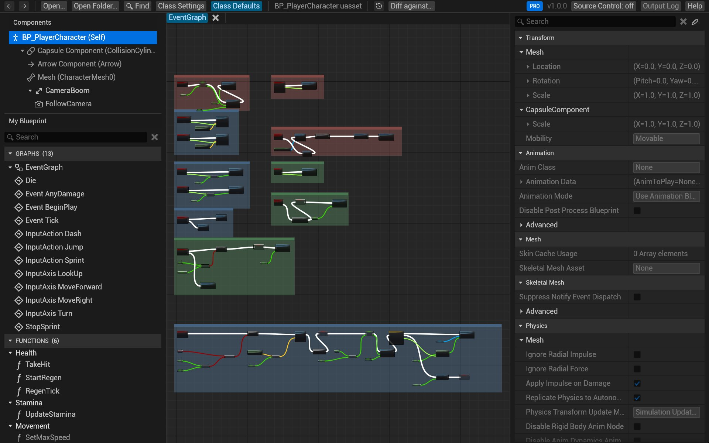

### Before you upgrade

- **The two Unreal plugins are now one, *Blueprint Review*** (Fab doesn't allow a plugin to depend on another). Delete `Plugins/BlueprintExporter` and `Plugins/BlueprintEditAutomation` from your project, then install and enable `BlueprintReview` (`scripts/deploy_plugin.py` does both). Commandlets, console commands and menu entries are unchanged. The Converter Path setting carries over; if it doesn't, set it again under *Editor Preferences > Plugins > Blueprint Review*.

### New

- **Diffs open in the app from the editor:** Content Browser *Diff Selected*, Revision Control *Diff Against Depot*, the History window and the Blueprint editor's *Diff* menu start `blueprintreview-app --diff` with the revision labels. When the app is missing, or a side has unsaved changes, the editor's own diff window opens instead.
- **Sync with the Unreal editor** (desktop app, diff view): the *Sync* button ties the new side's graph to the Blueprint open in the editor, opening it there if needed. Pan, zoom, selection and the shown graph follow both ways. The button appears when the plugin's `Saved/BlueprintReview/link.json` is found above the file; the status reads *Connected to UE 5.7*, *Editor not found* or *Connection lost*.
- **Sync reloads on save:** saving the Blueprint in the editor refreshes the diff against the same old version, keeping the open graphs, view and selection (*Reloaded after save*).
- **Animation Blueprints:** state machines are drawn as in the editor (states, conduits, aliases, entry, transition arrows), pose pins and *Output Pose* look as in the editor, and *My Blueprint* lists *Animation Graphs* and *Animation Layers* with their state machines, states and rules.
- **Transition rules:** double-click a state machine, state, conduit or transition to open its graph in the same tab, with a path above the graph (*AnimGraph › Locomotion › Idle to Walk (rule)*) to go back up. Hovering a transition shows its rule in words, its priority and whether it's automatic or disabled.
- **Details for Animation Blueprint nodes:** a transition's *Transition*, *Blend Settings* and *Notifications*, a state's bound functions and notifies, an alias's states, and any anim node's settings by category, with the engine's defaults for what the asset doesn't save.
- **Local variables:** a function's tab adds *Local Variables (Function)* to *My Blueprint*; selecting one shows its name, type, description, category and default in *Details*. *Find in Blueprint*, *Copy* and diffs handle them as the editor does (*Local variable Tally::Count was a Integer but is now a Float*).
- **Find References** on the graph: right-click a variable's get or set node.
- Widget Blueprints list their *Is Variable* widgets under *Variables*. Levels (`.umap`) open as their Level Blueprint, and folder mode lists the levels that have one. Data assets (`DA_*`, input actions…) open as a table of their values. Redirectors open their target.
- **Developer Settings** in the version label's menu: *Show node internals in Details* shows a node's class, GUID, pins and saved properties (off by default, kept between runs).

### Improved

- **Components** lists the components the native parent class adds, named as the editor names them, with the Blueprint's own attached under them.
- **Class Defaults** look like the editor's: native components' properties in their categories (*Transform*, *Animation*, *Mesh*…), *Actor Tick*, *Advanced* groups, *Call In Editor* buttons, display names as labels, floats as `2.0` and empty references as *None*. What the editor hides (actor and component references, a parent's private variables, hidden categories) is hidden too.
- **Details** shows a node as the editor does: a variable get or set its variable, a function entry or custom event its signature, an animation node its settings, other nodes nothing. In a diff, an added or removed node still lists its pins.
- **Node titles as in the editor** for nodes that showed their class name: *Create Widget*, *Construct*, async tasks (*Async Save Game to Slot*), casts, enum and bitmask literals, local variables, *Get Data Table Row*, choosers, *Add Component*, every animation graph and state machine node, and Control Rig nodes.
- Functions and events of engine plugins (Mover, CommonUI, Smart Objects, Chooser, Pose Search and the rest that ship with the engine) show their display names (*On Clicked (Button)*). Your project's own C++ isn't covered yet.
- **Create Event** nodes show the delegate's signature and the selected function below their pins, and an unconnected Target or Object pin shows `self`.
- Nodes show the pins the editor adds when it opens an asset: parameters added to engine functions since the asset was saved (*Set Timer*'s *Max Once Per Frame*), and *Expose on Spawn* variables of the class a spawn node creates.
- **Find in Blueprint** and **Find in Blueprints** search inside state machines, states, transition rules and collapsed graphs, and a result opens that graph and selects the node. Diffs name a change inside a rule by the rule (*Idle to Walk (rule): …*).
- **Find References** finds the member itself, not every name containing it: *Health* no longer finds *MaxHealth* or *Set Health Bar*.
- **Diffs** list pins added to or removed from a node, variables added at their default under *Defaults*, and the values a Blueprint changes on a native component.
- **Diffs list only what the editor's diff lists:** settings a native component doesn't expose (a Niagara component's caches), inherited-component records that change nothing, and where the last compile found a called function are no longer changes.
- **Sync is fast with the app in front:** a round trip takes about 25 ms instead of about 0.7 s, as the plugin keeps a background editor at its normal frame rate while syncing (*Keep Editor Awake*, on by default). Poll and send intervals go down to 10 ms.
- **Sync starts from the diff:** turning it on (or reconnecting) sends the diff's graph, position, zoom and selection to the editor at once.

### Fixed

- A function's entry node takes its graph's name, so a renamed or copied function no longer shows another function's title, and a Blueprint Interface call no longer borrows an engine function's title. Event dispatcher calls read *Call Button Pressed*.
- Empty inherited-component records the engine drops on save are no longer reported as removed.
- *Find Results* and *Find in Blueprints* give a multi-line result the room it needs, instead of drawing it over the rows around it.
- *Guide*, *Troubleshooting*, *Buy* and the other website links open the browser in the desktop app; before, they did nothing.
- A level's external-actor files say what they are instead of *the package has no asset*.

### Plugin and CLI

- **Blueprint editing (experimental) follows the Blueprint style guides:** new nodes line up with their wires, getters go left of the input they feed, positions snap to the editor's 16 grid, and existing nodes are never moved. `"layout": "none"` keeps the old placement.
- **Style findings:** `blueprintreview edit validate` and `edit apply` report where a plan departs from Allar's and Unreal Directive's style guides and Epic's best practices (bools without `b`, names not in PascalCase, dispatchers without `On`, editable variables without a tooltip, unwired nodes, unhandled *Cast Failed*, functions past 50 nodes…), following the Blueprint's own naming where it has one. They are warnings; `"style": "strict"` or `--strict-style` makes them fail the plan.
- `blueprintreview textconv` lists local variables under their function's entry node, and `blueprintreview dump` writes them as `local_variables` (schema version 5; older JSON still opens).

## [1.2.0-beta4] - 2026-11-04

### Highlights

- **A step-by-step user guide.** Every task has a page at [blueprintreview.efenggamedev.com/docs/](https://blueprintreview.efenggamedev.com/docs/), with a sample project to follow along. *Help* at the top right opens it (or press F1), along with the shortcuts, the release notes and a way to report a problem.

  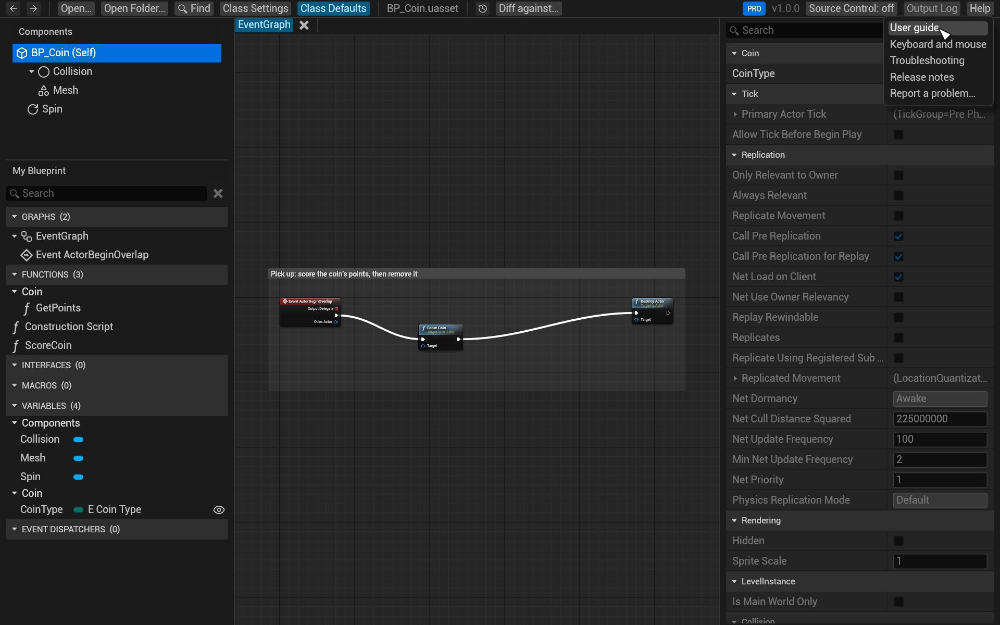

- **Try it in your browser.** No install and no sign-in: [blueprintreview.efenggamedev.com/try/](https://blueprintreview.efenggamedev.com/try/) opens a diff from a demo project's history, and *Samples* lists every Blueprint and change in it.
- **The beta has an end date.** Everything stays unlocked until the end of 30 November 2026. After that, BlueprintReview runs a 14-day Pro trial, then Lite. Beta testers' keys keep Pro for every 1.x version.

### New

- **A user guide** at [blueprintreview.efenggamedev.com/docs/](https://blueprintreview.efenggamedev.com/docs/): a page for every task (opening and searching Blueprints, comparing, git and Perforce, Time-lapse, pull requests, edit plans), with a sample project.
- **Try it in your browser** at [blueprintreview.efenggamedev.com/try/](https://blueprintreview.efenggamedev.com/try/): a diff from the demo project's history opens first; **Samples** lists its Blueprints and the guide's sample project's, with a diff for every change.
- **Help** at the top right opens the guide, the shortcuts and the release notes, or starts an email to support; F1 opens the guide.
- **Report a problem…** fills in the version, the system and the log folder; *Help* also copies the support address and opens the log folder. After a crash, the dialog says which backup log to send.
- **Advanced pins:** the arrow at the bottom of a node shows or hides its advanced pins, on both sides of a diff.
- **Find References** in *My Blueprint*'s right-click menu searches for a variable, function, event or component.
- The empty window has **Open…**, **Open Folder…** and **User guide** buttons, and a folder dropped on the window opens it. A file that won't open links to *Troubleshooting*.
- **The beta's end date:** everything stays unlocked until the end of 30 November 2026; then the 14-day Pro trial (counted from that date if you first started during the beta), then Lite. Beta testers' keys keep Pro for every 1.x version.

### Improved

- Variables, defaults and properties of a user-defined struct type show every field, with the editor's field names, instead of `()`.
- An enum asset lists its entries by name (*Walk*, *Run*), not as `NewEnumerator0`; the internal name is in the tooltip.
- The diff view outlines changed nodes with a thin line that follows the node's shape at every zoom (in reports too), and unchanged graphs in *Changes* are dimmed.
- Node icons are solid: the event diamond, the interface-message envelope and the server-only and client-only corner icons.
- *Remove license* asks first, and frees the license's place on the server before forgetting it (offline, it says so and offers *Forget it here anyway*). A license saved for another installation says so, with *Free its place*.
- The update check offers pre-releases only to pre-release builds.

### Fixed

- A file that trips over a bug in the reader shows *ran into an internal error*, and the app goes on: no crash dialog, no folder index stuck short of the end, no *Opening…* that never finishes.
- Data table diffs show a value the old row left at its default as that default, not as added.
- Nodes saved with their advanced pins shown open that way.
- An activation finishes even if the *License* window is closed meanwhile, connection errors read plainly, and a license that can't be saved says so.
- The license file is written safely: a crash while saving can't lose it, and a damaged one is kept as `License.json.bad`.
- Source control: a git or Perforce command that hangs stops after a minute, and git's own errors (*detected dubious ownership*) are shown instead of *Not in source control*.

### Plugin and CLI

- Blueprint Edit Automation: spawning nodes such as *Spawn Actor from Class* no longer crashes, a second *Return Node* gets one set of pins, an override event replaces the disabled ghost a new Blueprint has, and `set_root_component` replaces the default scene root. `blueprintreview edit apply` says where the editor stopped when it crashes.
- Blueprint editing (the plugin, edit plans and `blueprintreview edit`) is marked experimental: the plan format and the ops may still change.
- `blueprintreview textconv` prints a line about a file it can't read instead of failing `git diff`.

## [1.2.0-beta3] - 2026-11-03

### Highlights

- **The command-line tool is in the Start menu.** The Microsoft Store package lists *BlueprintReview CLI*. Started from there it shows its help and waits for Enter; from a terminal it works as before.

## [1.2.0-beta2] - 2026-11-03

### Highlights

- **A setup wizard for the installer.** It shows the license agreement, then *Install* for you alone, or *Advanced* to install for every user, choose the folder and pick what to install (the app, *Open with* for `.uasset` files, the command-line tool, adding it to `PATH`).

  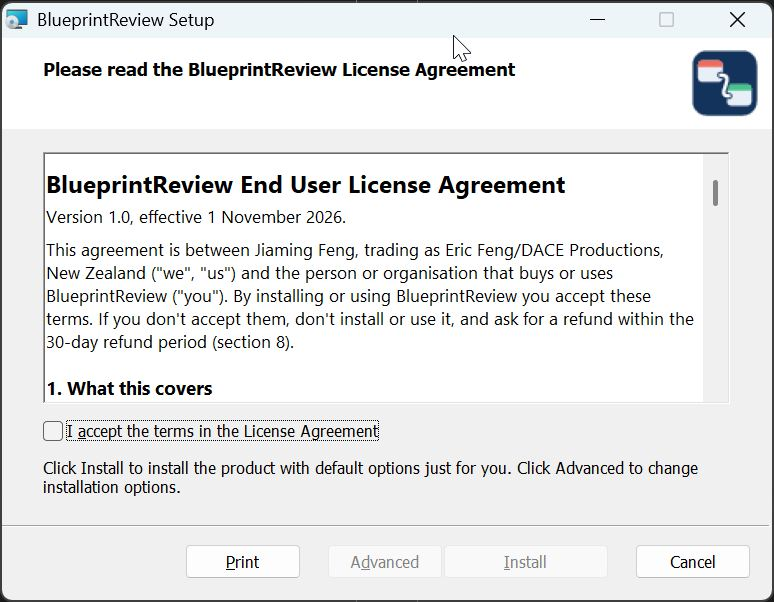

- **Updates go where you installed.** An update stays in your installation folder, and updates an every-user installation (asking for administrator rights) instead of refusing.

### Improved

- The last page of the installer can start BlueprintReview.
- The Linux downloads hold the command-line tool alone, and this release has no macOS build.

## [1.2.0-beta1] - 2026-11-02

### Highlights

- **Your asset's history, without leaving the app.** BlueprintReview finds git and Perforce on its own, and *Time-lapse* steps through every revision of the open asset, P4V-style, as a diff.

  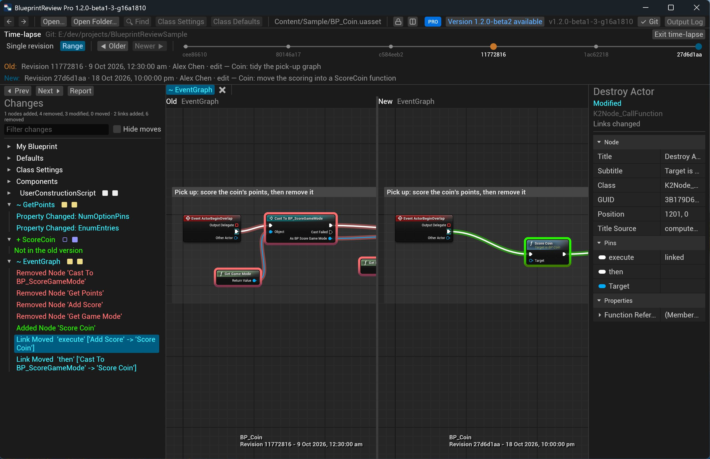

- **Diff reports to share.** A diff as a list of changes with side-by-side images of each changed graph, saved as one HTML file to share.

  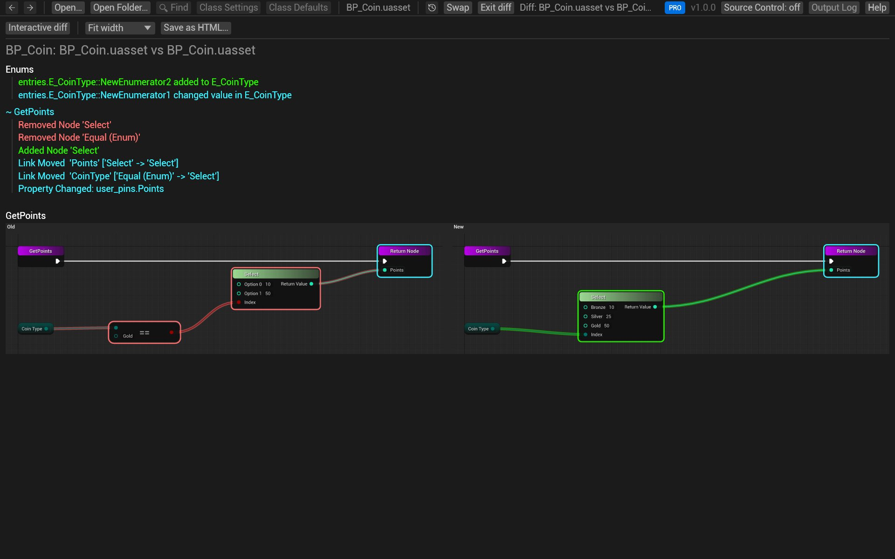

- **More than Blueprints.** Enums, structs and data tables open and diff, and timelines and inherited components are part of the diff.

### New

- **Source control:** git and Perforce for the open asset, and a P4V-style *Time-lapse* of its history.
- **Diff report:** a diff as a change list and side-by-side images of each changed graph, with *Save as HTML*. Lite shows diffs this way; Pro adds the interactive diff.
- Enum, struct and data table assets open, diff and have a `textconv` outline; timelines, user-defined structs and inherited component overrides are diffed.
- **Update check:** the app looks for a new version once a day and shows a *Version X available* button; the version label's menu turns it off or checks now.
- **Display scale:** Ctrl+scroll (outside graphs), Ctrl+= / Ctrl+- / Ctrl+0 or the version label's menu scale the whole window, kept between runs.
- Copy for *My Blueprint* items and *Details* values, as the editor copies them.
- *Lock/Unlock* and the split orientation in the diff view.

### Improved

- Re-routing a wire through reroute nodes is a cosmetic change.
- The Explorer's top row names the project of an opened `Content` folder (`MyGame/Content`), or its plugin.
- The app is always dark, as the editor is; the window title and a toolbar badge name the edition.

### Fixed

- The Windows exes start on a PC without the Visual C++ Redistributable (`VCRUNTIME140.dll` was not found).
- The installer won't install for every user while BlueprintReview is installed for you alone, or the other way round, and says what to do, instead of making two installations that can't be removed cleanly.

### Plugin and CLI

- **Blueprint editing:** the *Blueprint Edit Automation* plugin applies JSON edit plans to Blueprints, enums, structs and data tables, from a commandlet, the editor console or a local server in the open editor. `blueprintreview edit validate|apply|ops|schema` drives it ([EDITING.md](docs/EDITING.md)).
- Generated C++ files no longer name the converter's version in their header, so regenerating only changes files whose code changed. The `.bpmap.json` manifests still record it.

## [1.1.1] - 2026-10-25

### Highlights

- **Folders open without freezing the window.** Every file opens in the background, diffs included, and the Explorer shows its indexing progress.
- **No more crash when opening a folder.** The folder dialog no longer crashes the app, and the folder opens at the click.

### Fixed

- Windows builds draw with Vulkan again.
- The release archives ship `blueprintreview-app` next to the CLI.

## [1.1.0] - 2026-10-25

### Highlights

- **Open a whole project.** Open a `Content` folder to browse it in an *Explorer*, open assets in tabs, search every Blueprint at once (*Find in Blueprints*, Ctrl+Shift+F) and double-click into other Blueprints, with *Back* and *Forward*.

  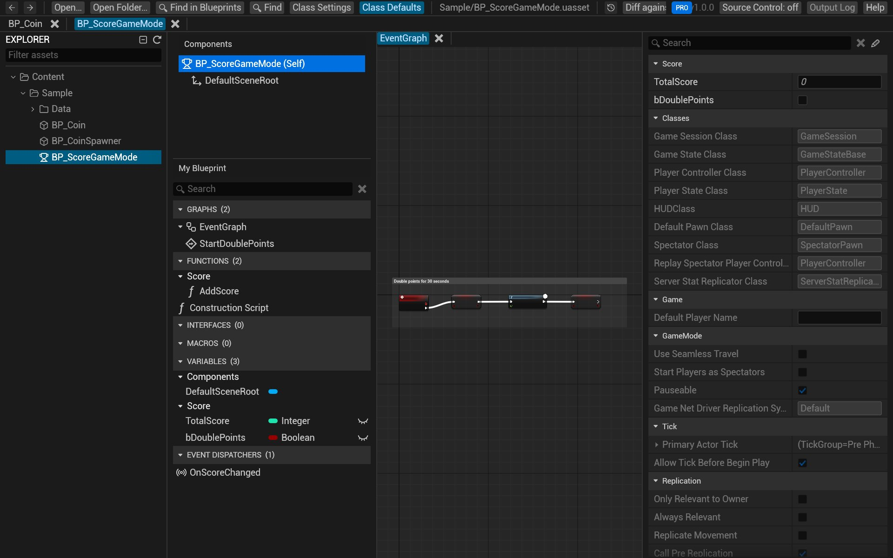

- **git in one command.** `blueprintreview git-setup` makes BlueprintReview your `git difftool` and teaches `git diff` to read Blueprints; `git difftool -d` lists every changed asset.

  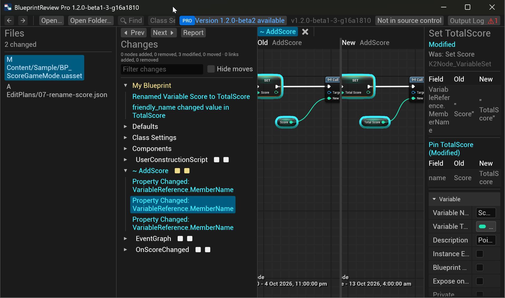

- **Perforce diffs in the app.** P4V's diff opens in BlueprintReview, each side labelled with its revision; `blueprintreview p4-setup` prints the steps.

### New

- An *Output Log* panel (Ctrl+`) and a log file; a crash dialog that points to the log.
- An app icon, and the version in the exes, the title bar and `blueprintreview --version`.

### Improved

- Clear messages for Git LFS pointer files, cooked assets, non-Blueprint assets and engines too old or too new.
- No console window behind the app.

### Plugin and CLI

- A preview of the Blueprint to C++ converter: `blueprintreview cpp`, and *Convert to C++…* in the editor plugin.

## [1.0.0] - 2026-10-17

### Highlights

- **See Blueprints without Unreal.** Open uncooked `.uasset` files from UE 4 and UE 5 and read their graphs as the Blueprint editor draws them, with *My Blueprint*, *Components* and *Details*.

  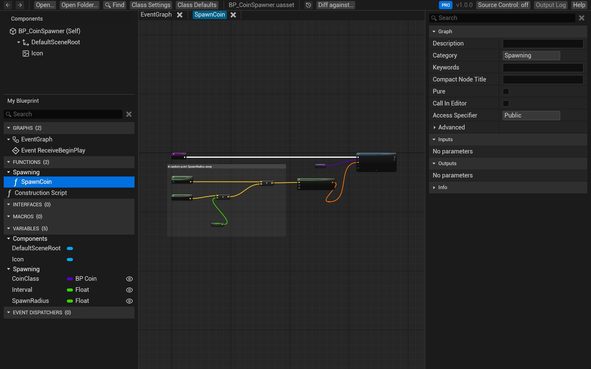

- **Compare two versions side by side.** The diff is laid out like the editor's *Blueprint Diff* window, from *Diff against…* or as your `git difftool`.

  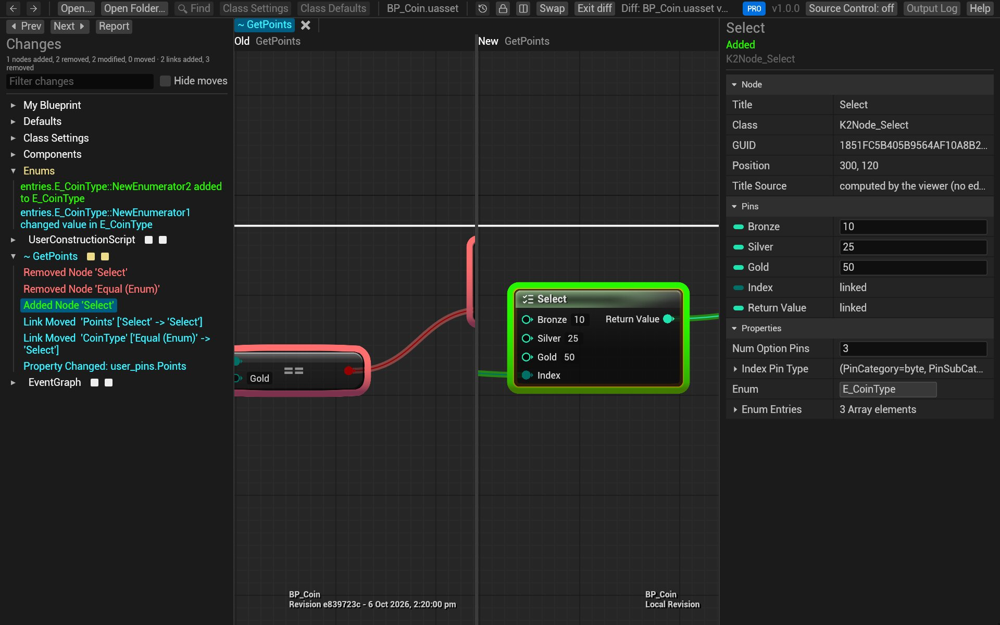

- **Blueprint changes in `git diff` and pull requests.** `blueprintreview textconv` turns "Binary files differ" into readable text, and the GitHub Action comments on a pull request with the Blueprint changes and links to an interactive diff.

  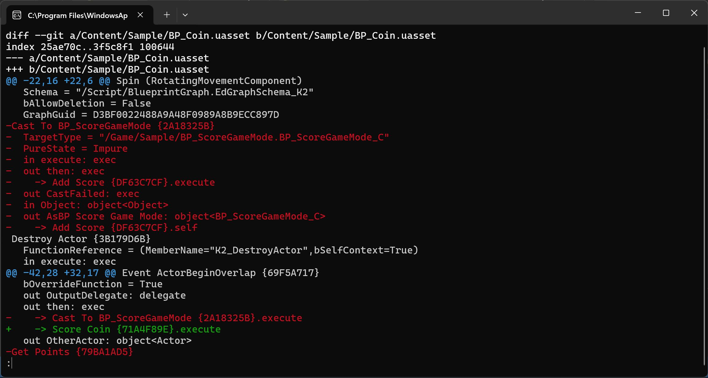

### New

- Copy a node selection (Ctrl+C) as the editor's copy text, to paste into the Blueprint editor or blueprintue.com.
- *Find in Blueprint* (Ctrl+F) across graphs, variables and functions.
- Each side of a diff is labelled with its revision.

### Plugin and CLI

- `blueprintreview diff` (Markdown or JSON) and `blueprintreview render --format svg` for reviews and scripts.
- The CLI's `info`, `props`, `dump`, `check`, `copy` and `schema` commands, and the `BlueprintExporter` editor plugin that exports the same JSON from inside UE.
