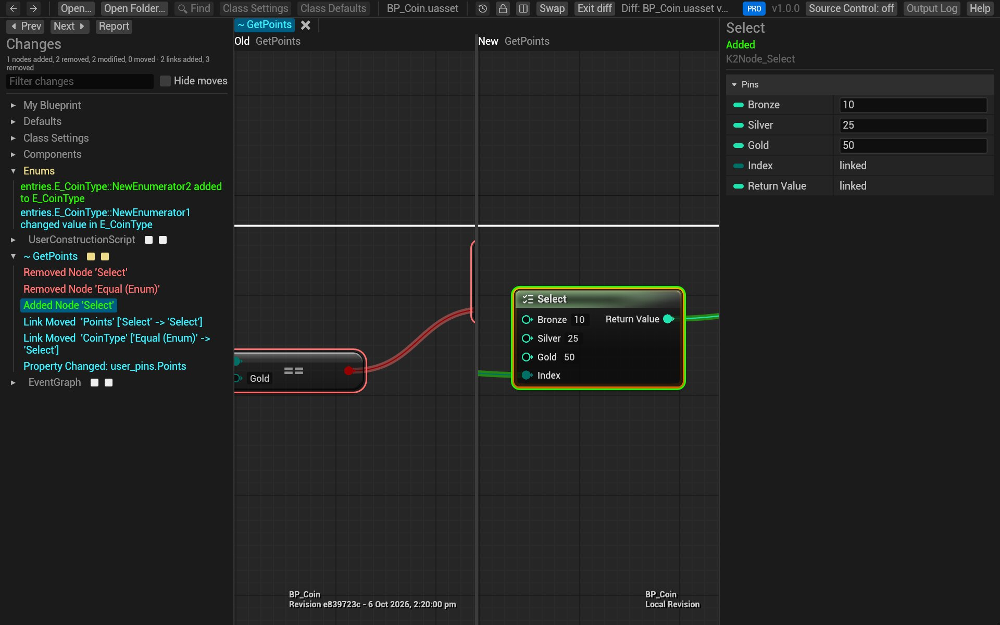
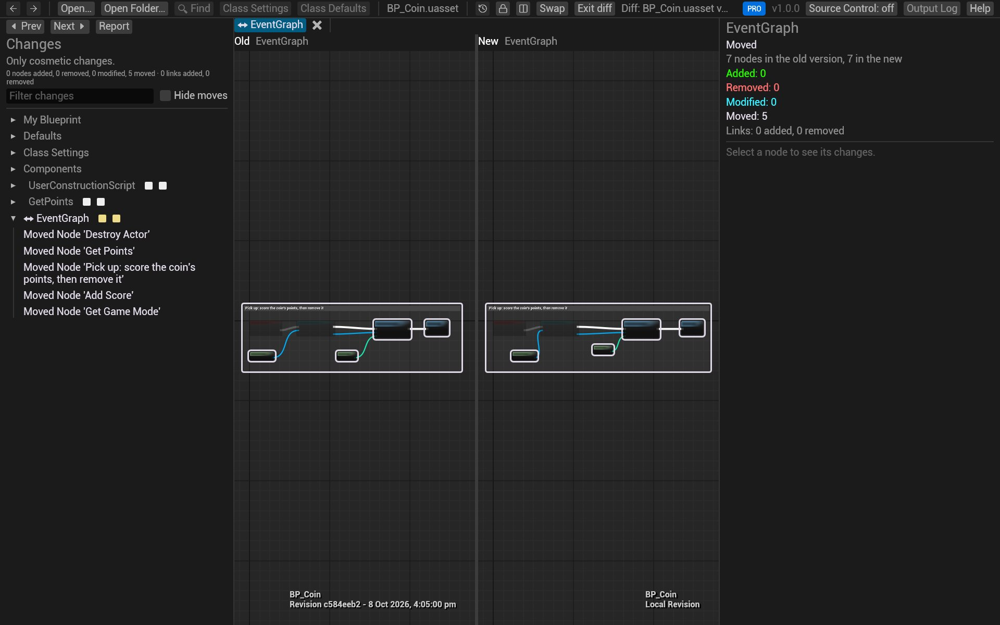
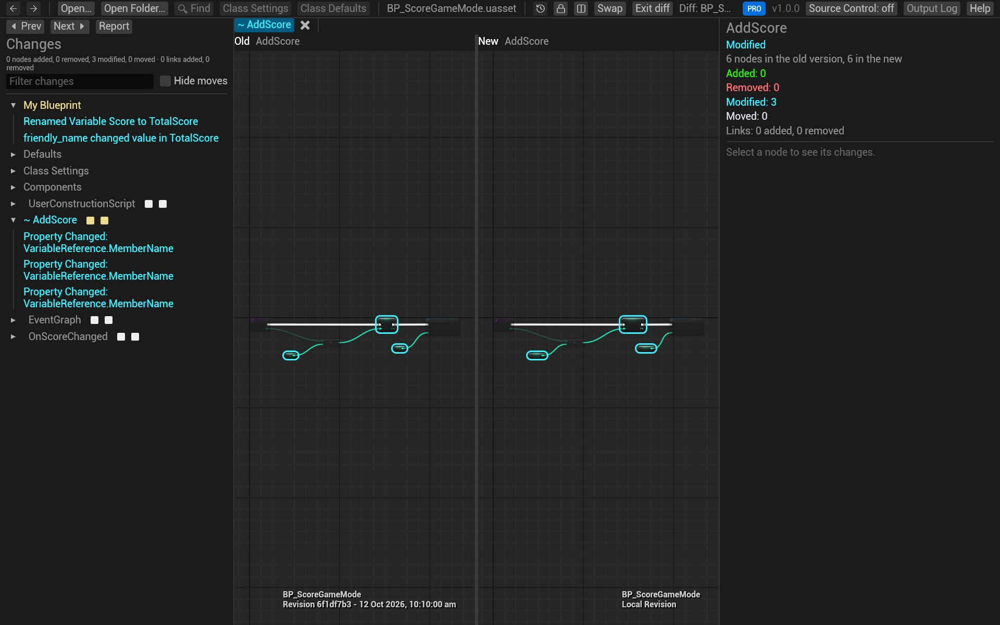
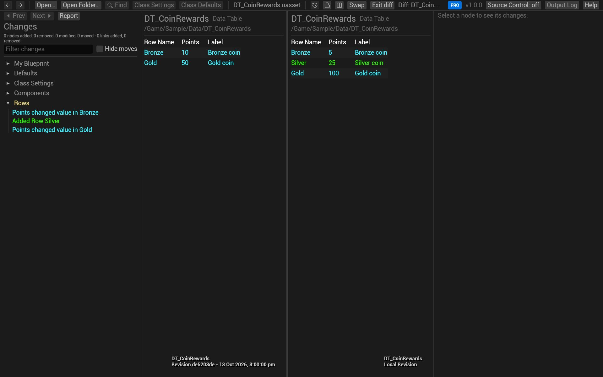
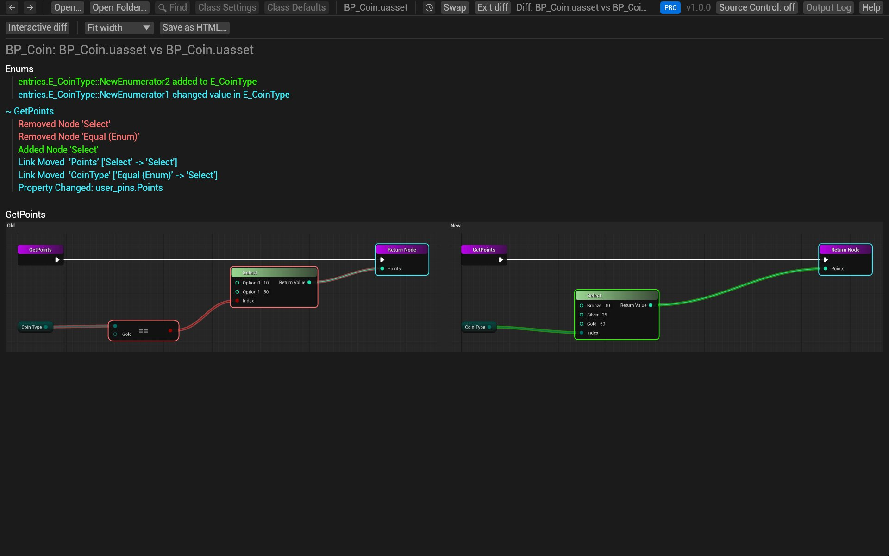

# Compare two versions

See exactly what changed between two versions of a Blueprint, laid out like the editor's *Blueprint Diff* window:
the old version on the left, the new on the right, and every difference listed in the editor's wording. Enums,
structs and data tables compare too, as tables.

> **Pro:** the interactive diff on this page is part of Pro (and the trial). Lite shows the same diff as a
> [report](#the-report).

## Steps

1. Open the newer version of the asset.
2. Click **Diff against…** in the toolbar and pick the older version's file.
3. The diff view opens:
   - **Changes** on the left lists the differences, by category: *My Blueprint* (variables), *Defaults*,
     *Class Settings*, *Components*, then each graph. A category with differences is yellow.
   - The graphs show the old version on the left and the new one on the right.
   - **Details** on the right shows the selected node's changes, old and new value side by side.
4. Click a row in *Changes* to jump to it: its graph opens and the node is framed on both sides. **Prev** and
   **Next** step through every difference in turn.



From git or Perforce you don't need to find the files yourself: see [Review changes in git](review-git.md) and
[Review changes in Perforce](review-perforce.md).

## Reading the diff

| Colour | Means |
|---|---|
| Green | added |
| Red | removed |
| Cyan | changed: a property, a pin's default, its wires |
| Grey-violet | moved only |

A change to a node outlines the node; a change to one pin (a default value, a new wire) outlines just the pin.
Added and removed wires get a glow in the same colours. Zoomed out far, unchanged nodes fade so the changes stand
out.

The rows use the editor's words, for example `Added Node 'Select'`, `Pin Default 'Duration' ['1.0' -> '2.0']`
or `Renamed Variable Score to TotalScore`. Hover a row for more detail.

### Moves and re-routes aren't changes

Moving nodes, re-routing a wire through reroute nodes, or changing a comment's colour doesn't change what a
Blueprint does. These rows are listed separately (as *Moved Node*, and greyed out), and the summary counts them
apart. Tick **Hide moves** to leave them out entirely.



### Variables, defaults and components

Click a row under *My Blueprint*, *Defaults*, *Class Settings* or *Components* and the graphs make way for both
versions' details side by side, rows lined up, the differing ones highlighted. A renamed variable is matched with
its old self, so you see *Renamed Variable* and the nodes that follow it, not a removal and an addition.



### Data tables, enums and structs

These show as tables, old and new side by side: added rows in green, changed values in cyan.



## The toolbar

| Button | What it does |
|---|---|
| Padlock (**Lock/Unlock**) | Locked, both sides pan and zoom together; unlocked, each moves on its own |
| Split | Side by side, or the old graph above the new one |
| **Swap** | Exchanges the old and new versions |
| **Exit diff** | Back to the plain view of the new version |
| **Report** (above *Changes*) | The same diff as a single page; see below |
| **Sync** | With the Blueprint Review plugin in the open Unreal editor: the graph, pan, zoom and selection follow the editor's both ways ([the plugin's page](../PLUGIN.md#9-diffs-in-the-blueprintreview-app-and-view-sync)). Shown only when the plugin is found |

The filter box under the summary keeps the rows whose text contains what you type (`Delay`, a variable's name, a
graph's name).

## The report

**Report** shows the diff as a document: the list of changes, then each changed graph's old and new version side
by side as one image. **Fit width**, 50%, 100% and 200% size the images, and **Save as HTML…** writes the whole
report as one file that opens in any browser. **Interactive diff** goes back. In Lite, every diff opens as its
report.



## Try it on the sample

1. In the sample's folder, compare today's `BP_Coin` with the one from the first commits (git hands BlueprintReview
   both files; [Review changes in git](review-git.md) explains the command):

   ```sh
   git difftool -y -t blueprintreview HEAD~11 -- Content/Sample/BP_Coin.uasset
   ```

2. Under *GetPoints* in *Changes*, click **Added Node 'Select'**: the new Select node is framed, its options
   Bronze, Silver, Gold and Platinum in *Details*.
3. Under *Components*, click **Spin**: the component added by the "spin" commit, its rotation rate in *Details*.
4. Tick **Hide moves**: the *Moved Node* rows from the "tidy the pick-up graph" commit disappear.

## Related

- [Review changes in git](review-git.md)
- [Time-lapse: an asset's history](timelapse.md)
- [Share a diff](share.md)
