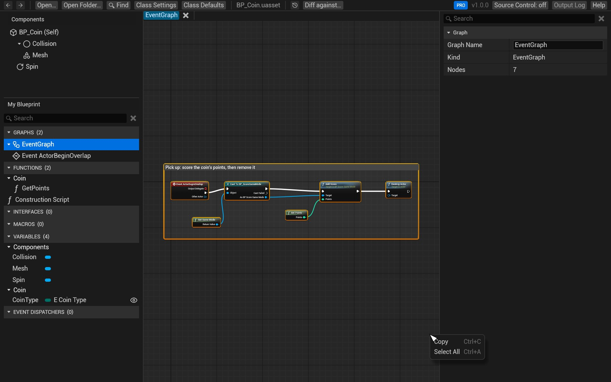

# Copy nodes

Copy nodes from BlueprintReview and paste them into the Unreal Blueprint editor, or into
[blueprintue.com](https://blueprintue.com) to share them. The copy is the editor's own copy text, so the nodes
paste with their pins, values and wires.

## Steps

1. Open the Blueprint and the graph with the nodes.
2. Select the nodes:
   - click a node; <kbd>Shift</kbd>+click to add more, <kbd>Ctrl</kbd>+click to toggle one;
   - or drag a box on empty space (a comment is picked by its title bar);
   - or press <kbd>Ctrl</kbd>+<kbd>A</kbd> for the whole graph (with the pointer over it).
3. Press <kbd>Ctrl</kbd>+<kbd>C</kbd>, or right-click and choose **Copy**.
4. In the Unreal editor, open a Blueprint graph and press <kbd>Ctrl</kbd>+<kbd>V</kbd>. On blueprintue.com,
   paste into the page's box.



Wires between copied nodes come along; wires to nodes you didn't copy are left out, as in the editor. Nodes that
call functions or read variables the target Blueprint doesn't have paste as they do in the editor: with a warning
until you add them.

You can also copy a variable or a graph from *My Blueprint* (right-click → **Copy**), and a value from *Details*
(right-click a row → **Copy**, **Copy Display Name** or **Copy Internal Name**).

## From the command line

`blueprintreview copy` prints the same text, for a whole graph or chosen nodes:

```sh
blueprintreview copy Content/Sample/BP_Coin.uasset --graph EventGraph > nodes.txt
```

See the [command-line reference](../CLI.md#blueprintreview-copy--nodes-as-copy-text) for its options.

## Try it on the sample

1. Open `Content/Sample/BP_Coin.uasset`.
2. In the event graph, drag a box around *Event ActorBeginOverlap* and *Score Coin*.
3. Press <kbd>Ctrl</kbd>+<kbd>C</kbd> and paste into a text editor: you'll see the `Begin Object` blocks the
   editor pastes from.

## Related

- [Open and browse](open-and-browse.md)
- [Share a diff](share.md)
