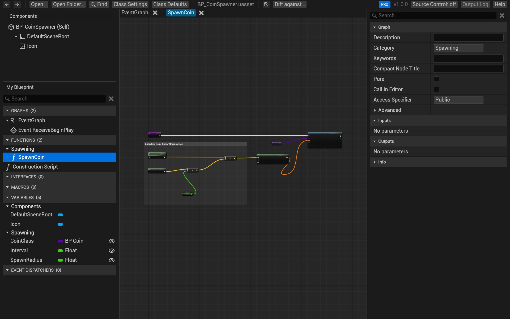
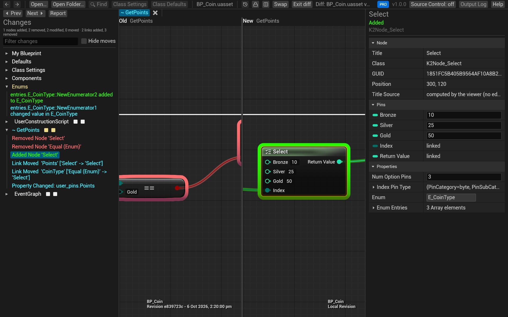

# BlueprintReview user guide

BlueprintReview opens Unreal Engine Blueprints (`.uasset` files) without the editor. You can read their graphs,
variables, components and defaults, search them, copy nodes into the editor, and compare two versions side by
side, from your desktop, from `git` or Perforce, or in a GitHub pull request.

## What it opens

- **Uncooked editor assets** saved by UE 4.25 to 4.27 and 5.0 to 5.8: Blueprints (actors, components, game modes,
  function libraries, interfaces, macros), and user-defined enums, structs and data tables.
- **Not cooked assets** from a packaged game: cooking strips the graphs, so there is nothing left to show.

BlueprintReview only reads files. Nothing you open is changed, uploaded or sent anywhere.

## Start here

1. [Install BlueprintReview](install.md) on Windows.
2. [Get the sample project](get-the-sample.md): a small coin collector with a history made for these guides. Every
   page below has a *Try it on the sample* section that uses it.
3. [Open and browse a Blueprint](open-and-browse.md).

## Everyday tasks

| I want to… | Page |
|---|---|
| Read a Blueprint or a whole project | [Open and browse](open-and-browse.md) |
| Find where a variable, function or node is used | [Search](search.md) |
| Paste nodes into the editor or blueprintue.com | [Copy nodes](copy-nodes.md) |
| See what changed between two versions | [Compare two versions](compare.md) |
| Review a commit or a branch | [Review changes in git](review-git.md) |
| Review a changelist | [Review changes in Perforce](review-perforce.md) |
| See how an asset changed over time | [Time-lapse](timelapse.md) |
| Review Blueprint changes in a pull request | [Review pull requests](review-prs.md) |
| Send a diff to someone without BlueprintReview | [Share a diff](share.md) |
| Change Blueprints from a script or an AI agent (experimental) | [Your first edit plan](edit-tutorial.md) |

## Lite and Pro

BlueprintReview has two editions. **Lite** is free: it opens and searches Blueprints, copies nodes, and shows a
diff as a report. **Pro** adds the interactive side-by-side diff, Time-lapse, and the `blueprintreview diff` and
`blueprintreview render` commands. A new install runs as Pro for 14 days. Pages mark what needs Pro;
[Editions and licenses](license.md) has the details.

## Help

- **Help** at the top right of the app opens this guide (or press <kbd>F1</kbd>).
- [Troubleshooting](troubleshooting.md) covers files that won't open or look wrong.
- Write to [support@efenggamedev.com](mailto:support@efenggamedev.com), with the file if you can.
