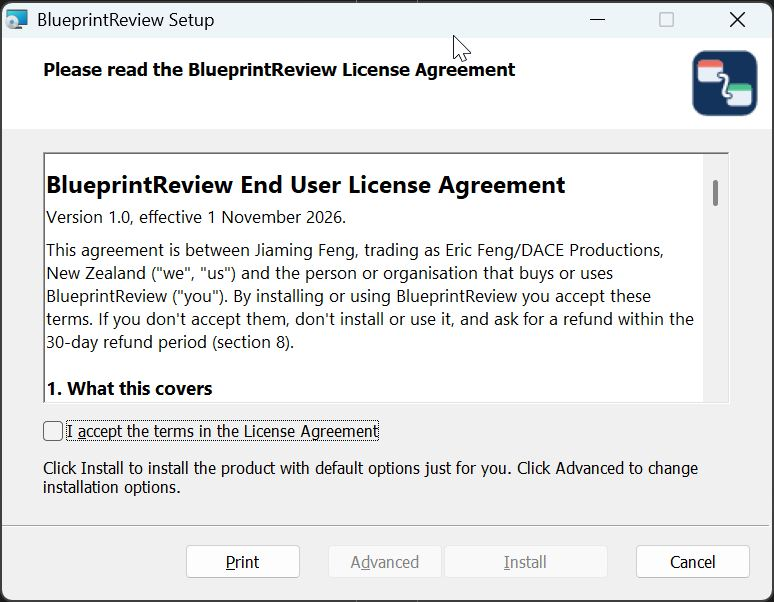

# Install

BlueprintReview runs on Windows 10 and 11 (64-bit). The command-line tool, `blueprintreview`, also runs on Linux
(x64 and arm64). There's no macOS build yet.

## Before you start

- Download the newest version from the [BlueprintReview site](https://blueprintreview.efenggamedev.com/). It
  links to two files: the installer (`.msi`) and a zip.
- You don't need Unreal Engine installed, or administrator rights for a normal install.

## Install with the installer

1. Run `blueprintreview-app-x86_64-pc-windows-msvc.msi`.
2. The installer isn't code-signed yet, so Windows SmartScreen may stop it: click **More info**, then
   **Run anyway**.
3. Read the license agreement, tick the box to accept it, and click **Install**. This installs for you alone into
   `%LOCALAPPDATA%\Programs\BlueprintReview`, without administrator rights.
   - Click **Advanced** instead to install for every user of the PC (Windows asks for administrator rights), to
     pick another folder, or to choose the parts: the app (with or without the *Open with* entry for `.uasset`
     files) and the command-line tool (with or without adding it to `PATH`).
4. On the last page, leave **Launch BlueprintReview** ticked and click **Finish**.



The installer adds a Start menu entry, puts `blueprintreview` on your `PATH`, and adds BlueprintReview to
Explorer's *Open with* list for `.uasset` files. It doesn't make itself the default program for them.

### For every user, from a script

From an administrator prompt:

```bat
msiexec /i blueprintreview-app-x86_64-pc-windows-msvc.msi ALLUSERS=1 /qn
```

This installs into `C:\Program Files\BlueprintReview`, uses the system `PATH`, and shows no window. Install updates
the same way. A PC has either a per-user or an all-users install, not both: uninstall one before switching.

## Or unpack the zip

Unpack `blueprintreview-app-x86_64-pc-windows-msvc.zip` into a folder of its own and run `blueprintreview-app.exe`.
Keep `blueprintreview-app.exe` and `blueprintreview.exe` together: the git setup looks for the app next to the
command-line tool. Add the folder to your `PATH` to use `blueprintreview` from any terminal.

## Check it works

1. Start **BlueprintReview** from the Start menu. An empty window opens, with **Open…** and **Open Folder…** at
   the top left.
2. In a new terminal, run:

   ```sh
   blueprintreview --version
   ```

   It prints the version. If the command isn't found, open a new terminal (the installer changed `PATH`), or
   check that the folder is on your `PATH`.

## Updates

Once a day, at start-up, BlueprintReview checks the site for a newer version. When there is one, a
**Version X available** button appears at the top right; it opens the download page. Nothing installs by itself.
Run the new installer over the old version: your settings and license stay.

To turn the check off, click the version number at the top right and untick **Check for updates daily**.

## Uninstall

*Settings → Apps → Installed apps → BlueprintReview → Uninstall*. For the zip, delete its folder. Your settings and
logs are in `%LOCALAPPDATA%\BlueprintReview`; delete that folder too to remove everything.

## Next

[Get the sample project](get-the-sample.md) to follow the other guides, or go straight to
[Open and browse a Blueprint](open-and-browse.md).
