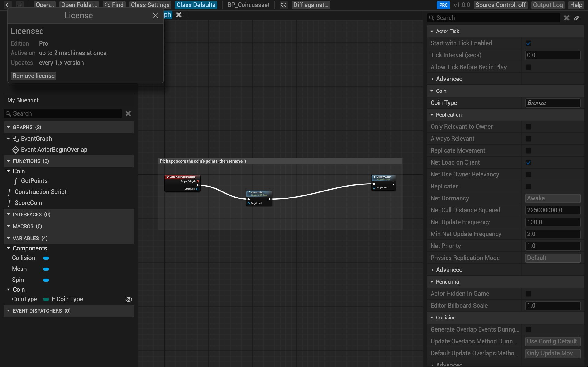

# Editions and licenses

## Lite and Pro

| | Lite (free) | Pro |
|---|---|---|
| Open and browse Blueprints, enums, structs, data tables, whole folders | ✓ | ✓ |
| Find, Find in Blueprints, copy nodes | ✓ | ✓ |
| `git diff` as text, the GitHub Action's comment | ✓ | ✓ |
| A diff as a report, *Save as HTML* | ✓ | ✓ |
| The interactive side-by-side diff | | ✓ |
| Time-lapse | | ✓ |
| `blueprintreview diff` and `blueprintreview render` | | ✓ |

The GitHub Action's pull-request comment is free for every repository. The interactive diff viewer its links open will
come with Team, when it ships.

A new install runs as Pro for **14 days**, with nothing to register. After that it runs as Lite until you activate
a license. During the beta, until the end of 30 November 2026, everything is unlocked; the 14 days start when the beta ends,
if you first started BlueprintReview during it.

The label at the top right says where you stand, and so does the window title:

| Label | Means |
|---|---|
| **PRO TRIAL · 12 DAYS** | the trial, with the days left |
| **BETA** | the beta: everything is unlocked |
| **LITE** | the trial ended; Pro's buttons are marked *PRO* |
| **PRO** | licensed |

In the trial's last three days, and once after it ends, a thin bar under the toolbar reminds you; **Not now** hides
it until the next day.

## Buy a license

Pro licenses are on the [pricing page](https://blueprintreview.efenggamedev.com/#pricing): a Pro license for one
person on up to two computers, or a Team license with a seat per person. The key arrives by email from
`licenses@efenggamedev.com`.

## Activate it

1. Click **Activate…** at the top right (in Lite, **Upgrade…**), or click the label next to it.
2. Paste your key into the *License* window and click **Activate**.

Activation happens once per computer, online: it sends the key and an anonymous machine ID (a hash, never your
computer's name). After that the license is checked offline, so BlueprintReview works without a connection. The
version number's menu at the top right has **License…** to open the window again.

## Move it to another computer

A Pro key is active on two computers at once, a Team key on as many as it has seats.

1. On the old computer, open the *License* window, click **Remove license**, and confirm. That frees its place
   (it needs a connection; offline, the license stays until it can, or **Forget it here anyway** drops it).
2. On the new one, activate the key as above.

After reinstalling Windows, the *License* window says the saved license doesn't apply: **Free its place** frees the
old installation's seat, then activate the key again. If the old computer is gone for good, write to
[support@efenggamedev.com](mailto:support@efenggamedev.com) with your key, and we'll free its place.

## Privacy

Apart from activation and the daily update check (which reads the newest version number), BlueprintReview makes
no network calls. Your assets never leave your computer. See the [privacy policy](https://blueprintreview.efenggamedev.com/privacy.html).
