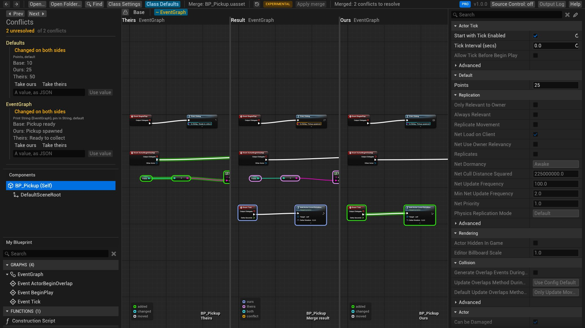
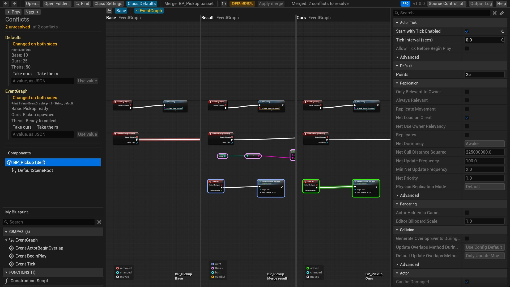
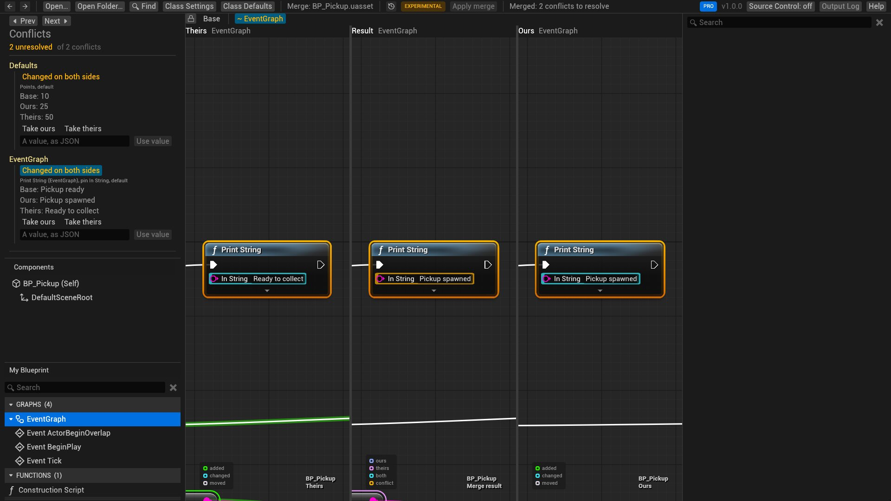
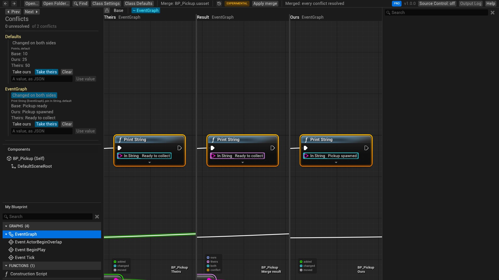

# Merge two branches of a Blueprint

When two people change the same Blueprint on two branches, git and Perforce can't combine the two `.uasset` files:
one of you has to take the other's file and redo your own work by hand. BlueprintReview merges them for you. It
takes every change that only one side made, lists the few places where both sides changed the same thing, lets you
pick a side for each, shows you the merged Blueprint, and then writes it into the `.uasset` through the Unreal
editor.

> **Pro:** the merge view and `blueprintreview merge` are part of Pro (and the trial). Lite lists the conflicts
> read-only.

> **Experimental:** the three-way merge is experimental: the merge view, `blueprintreview merge` and writing the
> result (*Apply merge*, `blueprintreview merge -o`, which uses the BlueprintReview plugin's Blueprint editing). Keep
> the project under source control, and look at the merged Blueprint in the editor before you commit it. Reading the
> three versions, the conflicts and the preview never change a file.

This page uses a small example, `BP_Pickup`, rather than the sample project: one Blueprint changed on two branches.
Its three versions are in the BlueprintReview repository, in `fixtures/merge/BP_Pickup/`.

## What a three-way merge is

A merge looks at three versions of the asset:

| Version | git calls it | What it is |
|---|---|---|
| **Base** | `$BASE` | the version both branches started from |
| **Ours** | `$LOCAL` | your branch, the one you're on |
| **Theirs** | `$REMOTE` | the branch you're merging in |

Each side is compared with the base, item by item: every variable, default, component, graph, node, pin default
and wire.

- Changed on one side only: the merge takes that side's change.
- Changed the same way on both sides: taken once, no question asked.
- Changed differently on both sides: a **conflict**. You choose.

Node moves and comment box sizes never conflict: where both sides moved a node, ours wins.

In `BP_Pickup`, theirs prints the points when the player overlaps the pickup, and ours spins it on Tick. Those two
changes merge on their own. Both branches also changed the `Points` default (25 on ours, 50 on theirs) and the
text of the Print String in BeginPlay: those are the two conflicts.

## When you need it

- `git merge` or `git rebase` stops with `CONFLICT (content): Merge conflict in Content/…/BP_X.uasset`.
- `git pull` does the same on a branch someone else pushed to.
- In Perforce, `p4 resolve` (or P4V's *Resolve*) can't merge a `.uasset` your shelf or pending change has in
  common with a newer revision at the head of the depot.

## Set it up with git

Once, in a terminal, in your project's repository:

```sh
blueprintreview git-setup
```

It sets up the merge tool, the diff tool and `git diff` for Blueprints, and adds lines to `.gitattributes` (commit
them) so that a conflicted `.uasset` keeps your version of the asset; without them, with Git LFS, git merges the
small LFS pointer files as text and leaves conflict markers where the asset should be. `blueprintreview git-setup
--global` sets it up for all your repositories instead.

Then, whenever a merge stops on a Blueprint:

```sh
git mergetool -t blueprintreview -- Content/Pickups/BP_Pickup.uasset
```

Leave the path out to go through every conflicted asset in turn. git hands the app the base, ours and theirs as
temporary files beside the asset, and the asset itself (still ours) as the file to write. When you close the app,
git takes the asset as merged if you applied the merge, and asks *Was the merge successful?* otherwise: answer `n`
to leave it conflicted. Then commit as usual.

## With Perforce

P4V's merge tool setting isn't supported yet: P4V gives the merge tool a temporary result file outside your
project, and BlueprintReview can only write the merge into the project's own file. Until then, do it by hand:

1. Get the two other versions as files:

   ```sh
   p4 print -q -o base.uasset //depot/Game/Content/BP_Pickup.uasset#5
   p4 print -q -o theirs.uasset //depot/Game/Content/BP_Pickup.uasset#7
   ```

   `#5` is the revision both started from, `#7` the newer one (for a shelf: `@=1234`).
2. Accept yours for the file (`p4 resolve -ay` on it, or *Accept Target* in P4V), so your workspace file is ours.
3. Open the merge with your workspace file as both ours and the result:

   ```sh
   blueprintreview-app --merge base.uasset Content/BP_Pickup.uasset theirs.uasset Content/BP_Pickup.uasset
   ```

## The merge view

The merge view opens on the first graph either side changed.



- **Three graphs, side by side:** **Theirs** on the left, the **Result** in the middle, **Ours** on the right.
  They pan and zoom together; the padlock above them unlocks them.
- **A legend** in the bottom-left corner of each graph says what its outlines mean; point at a line of it for more.
- **The side graphs** are coloured as in [the diff view](compare.md#reading-the-diff), each against the base:
  green added, cyan changed, grey-violet only moved (red removed shows on **Base**, the version it was removed
  from). These outlines say what that branch did, not that something conflicts: a node theirs gave a new pin is
  green or cyan on **Theirs** even when the merge takes it without a question. Conflicts are orange, on the
  **Result**, and listed in **Conflicts**. A change only to a node's pins marks those pins, and the whole node only
  when zoomed out far.
- **The result** is coloured by where each node's version comes from (a node changed only in its pins, such as a
  new timeline track's pin, has just those pins marked, and is outlined only when zoomed out far):

  | Colour | Means |
  |---|---|
  | Blue | from ours |
  | Magenta | from theirs |
  | Cyan | the same change on both sides, or changes from both on one node |
  | Orange | a conflict is left on it |

  In the picture, the Tick nodes come from ours (blue) and the overlap's Append and Print String from theirs
  (magenta); the BeginPlay Print String is orange.
- **Graph tabs** above the graphs list every graph either side changed. A tab with a conflict left in it is orange.
- **Base** (next to the padlock) shows the base version in place of theirs, to see what both started from. Click it
  again to go back.

  

- **My Blueprint** and **Details** show the result as it would be written: its variables, graphs, components and,
  with *Class Defaults* in the toolbar, its defaults. Click a node on the **Result** graph to see it in *Details*;
  click it on **Theirs**, **Base** or **Ours** to see that branch's version of it.

The toolbar says how many conflicts are left (`Merged: 2 conflicts to resolve`).

## Resolve the conflicts

**Conflicts**, on the left, lists every conflict, grouped by where it is (*Variables*, *Defaults*,
*Class Settings*, *Components*, then each graph). Each one says what both sides did (*Changed on both sides*,
*Removed on one side, changed on the other*, *Added on both sides*, *Type changed on one side, used by new nodes on
the other*, …), what it is about, and the base, ours and theirs values.

1. Click a conflict, or step through them with **Prev** and **Next**. Its graph opens and its node is framed on all
   three graphs. A conflict about a variable, a component, a class default or a class setting selects it in
   *My Blueprint*, *Components*, *Class Defaults* or *Class Settings* instead, so *Details* shows it. Click it again, or press
   Esc, to deselect it.

   

2. Choose:
   - **Take ours** or **Take theirs** keeps that side's version.
   - **Take both** keeps both, where both can stay: two items of the same name added on both sides, such as two
     variables, functions or custom events. Theirs is renamed with a number (`Ammo_1`), and its nodes follow.
   - **Your own value:** type it in the field and press Enter or **Use value**. It's written as JSON, in the form
     the conflict's values take in `blueprintreview merge --format json`: a pin's default is a quoted string
     (`"Ready!"`), a class default holds its type (`{"Int": 40}`). A value that isn't JSON is refused under the
     field.
3. The result changes at once. **Clear** takes a choice back.

Below the conflicts, **N changes merged** lists everything taken from one side without a question, in words, and which side: *BoostTime: default 0.0 → 2.0 (ours)*, *Added Delay to EventGraph (theirs)*, *Bob timeline: track Pulse added (theirs)*. Point at a change to see its path, the id `blueprintreview merge --format json` lists it under.

Click a change to see it, as you would a conflict: the row is highlighted and lists its base, ours and theirs
values (a whole node, component or graph by its name). A change in a graph opens that graph and frames its node on
the three graphs; a graph without the node says so across its top (*Not in ours*). A node one branch removed is
framed on the branch that still has it, and *Details* shows that branch's version (*Theirs' node*); one both
removed is framed on the **Base**, turned on for it (*Shown on Base: both sides removed it* under the row) and off
again when you deselect the row. A timeline's change frames its Timeline node. A variable, component, class default, class setting or
interface is selected in *My Blueprint*, *Components*, *Class Defaults* or *Class Settings*, and *Details* shows it.
An item the result doesn't have says so under the row (*Not shown: the variable is not in the result*). Click the
row again, or press Esc, to deselect it. Changes to an enum's entries, a struct's fields, a data table's
rows or a Widget Blueprint's designer only list their values: the merge view has no table or designer for them
(the *Output Log* says so).

To undo a change the merge took, use the buttons under it. The side the result has is highlighted:

- **Take ours** on a change from theirs keeps ours' version: theirs' new default isn't taken, a node theirs added
  isn't added (its new wires go with it), an item theirs removed stays.
- **Take theirs** on a change from ours does the same the other way round.
- **Clear** takes the override back. The row says *Overridden: ours taken* while one is in effect.

A change both branches made the same way has no buttons: either side's version is the same. Wires can't be
overridden on their own: the wires a branch added go only with their node. What belongs together follows:

- Undoing a variable, dispatcher or function a branch added also leaves out that branch's new nodes that use it;
  the merge's warnings list them (*removing it also removes 1 new node: Get Speed*).
- Undoing an interface a branch added or removed takes its function graphs along, and a dispatcher its signature.
- Undoing a parameter a branch added to a function or event leaves the node's own pins: the warnings name the
  pin rows to undo as well.

A few conflicts are different:

- **A removed node another side wired to:** keep the node with the new wires, or remove it and drop them.
- **A removed variable or function another side uses:** keep it, or remove it together with the new nodes that use
  it.
- **An exec output or a data input wired to two different places:** a pin like that holds one wire, so pick one.
- **Reparented differently:** pick a parent class.
- **A widget tree or a state machine changed on both sides:** these merge as a whole; pick one side's.
- **Two new enum entries with one internal name:** the enum editor names every new entry `NewEnumerator<N>`, so
  entries both branches added often share a name (ours' Diamond and theirs' Ruby both `NewEnumerator4`). **Take
  both** keeps theirs under a new internal name; **Take ours** leaves theirs' entry out. The conflict says what
  theirs' other assets that use the entry read once merged: they saved its old internal name, which is ours'
  entry now (or none), so check those assets after the merge.

Above the conflicts, **Warnings** in orange say what the merge did that may need a look elsewhere, such as theirs'
new enum entry merged with ours' entry of the same name, under ours' internal name: theirs' other assets that use it
may need checking. The command-line report lists them too.

When every conflict has a choice, the toolbar says `Merged: every conflict resolved`, and **Apply merge** turns on.



## Apply the merge

**Apply merge** writes the result into the asset (git's `$MERGED`, your working copy). It needs:

- UE 5.7 or 5.8 installed, with the [BlueprintReview plugin](../PLUGIN.md) enabled in the project;
- the asset inside an Unreal project (the app looks for the `.uproject` above it);
- `blueprintreview` beside the app (the installer puts both in one folder).

BlueprintReview never writes `.uasset` bytes itself: Unreal does, through the plugin. What happens:

1. **The file is backed up.** If the asset isn't ours yet, ours is copied there first, and the old file goes to
   `BP_Pickup.uasset.orig` (`.orig.1`, … when that exists).
2. **A dry run.** The merge is tried in Unreal without saving. A merge that doesn't compile stops here: the
   compiler's messages are shown, nothing is saved, and the asset stays ours. This can happen when the branches
   only fit apart, say theirs reads a variable that ours changed to another type.
3. **The merge is applied and saved.**
4. **A check.** The saved asset is read back and compared with the result you saw.

A window shows what the command printed. **Open the result** opens the written asset in a new tab.

**Editor closed or open?** With the Unreal editor closed, a commandlet starts Unreal in the background, which takes a
minute or so. With the editor open on the project, the editor applies the merge itself, and it shows as one undoable
change. The open editor merges into the asset it has loaded, so the asset must still be ours; if it isn't (you
applied once already, say), it refuses, and the window says so. Close the editor, or revert the asset in it, and
apply again. Assets `git merge` changed on disk while the editor had them open (a dependency only theirs changed,
say) are reloaded first, so the merge compiles against what git wrote; if one of them also has unsaved changes in
the editor, the merge stops and names it. If Unreal crashed and left its edit server's file behind, the merge
notices that nothing answers and uses a commandlet instead.

**What the check's notes mean.** The window ends with a count, such as
`The merge was written to …, with 2 differences from the merge.`, and a `note: the editor changed …` line for each.
They're information, not errors: the editor fixes some values up when it loads or compiles a Blueprint, and it picks
the place and object name of the nodes it adds. Nodes the editor makes itself (an added function's entry and result
nodes) get new IDs; the check matches them up and counts them separately. Look at the noted items in the editor before
you commit.

**When the check finds a loss.** If the saved asset is missing something the merge has (a node, a variable, a
graph, a component, an enum entry), the window says so in red, `The merge was written to …, but the saved asset lost
N things the merge has`, and lists them. The asset is written, but it isn't the merge: open it in the editor and add
what's missing, or merge again. `blueprintreview merge … -o` exits with `1` in this case, so a script running it
sees the failure.

**What Apply merge can't write yet.** Some changes can be merged and previewed, but not written back yet. Apply
merge then stops before touching anything and names the change. Take the other side for it, or redo that part by hand
in the editor after applying. See [What isn't supported yet](#what-isnt-supported-yet).

## From the command line

The same merge runs without the app, for scripts and build machines. See
[`blueprintreview merge`](../CLI.md#blueprintreview-merge--merge-two-changed-versions) for every option.

```sh
# The report: conflicts and merged changes (Markdown, or --format json for everything)
blueprintreview merge base.uasset ours.uasset theirs.uasset

# Your choices, keyed by each conflict's path from the report
blueprintreview merge base.uasset ours.uasset theirs.uasset --resolve choices.json

# The merge as an edit plan, for blueprintreview edit apply or a review
blueprintreview merge base.uasset ours.uasset theirs.uasset --resolve choices.json --plan merge.json

# Write it, as Apply merge does
blueprintreview merge base.uasset ours.uasset theirs.uasset --resolve choices.json \
    -o Content/Pickups/BP_Pickup.uasset --project PickupGame.uproject
```

The report for `BP_Pickup`:

```
## Merge of BP_Pickup

*Experimental: keep the project under source control, and look at the merged Blueprint in the editor before you commit it.*

**2 conflicts** (2 unresolved)

| Path | Kind | Base | Ours | Theirs | Choice |
|---|---|---|---|---|---|
| defaults[Points] | modified | 10 | 25 | 50 | – |
| graphs[266A…].nodes[1F18…].pins[D8F7…].default_value | modified | "Pickup ready" | "Pickup spawned" | "Ready to collect" | – |
```

A `choices.json` for it takes a value of your own for `Points` and theirs for the text (the paths in full, as the
report prints them):

```json
{
  "defaults[Points]": { "take": "value", "value": { "Int": 40 } },
  "graphs[266A508849682C33BA388D94BD6E87B8].nodes[1F189D274B07E0438A5FFBB229CC2C75].pins[D8F790D649722EE00D63AE8FC95A0708].default_value": { "take": "theirs" }
}
```

`take` is `ours`, `theirs`, `both` (where the conflict offers it) or `value`. The paths stay the same from run to
run, so one `choices.json` can be kept and reused. `--exit-code` exits with `1` while conflicts are left.

## Try it on the sample project

The [sample project](get-the-sample.md) has a merge test bed: two branches, `merge/ours` and `merge/theirs`, that
both start from `merge/base` (a commit on top of `main` with what the cases need) and change the same assets in
different ways. Every coin collector asset conflicts when you merge them:

| Asset | What the branches do |
|---|---|
| `BP_CoinSpawner` | the event graph: new events on both, EndPlay added on both, a print one side edits and the other removes, a pin default changed differently, a node disabled on one side and edited on the other, a wire to a removed node, moves, comment boxes, edits inside a collapsed graph, a reroute node added and one removed |
| `BP_ScoreGameMode` | members: new variables and functions on both, a function renamed while its body changes, a variable renamed differently, `TimeLeft` added on both with different types, a variable and a function removed while the other side uses or edits them, a parameter added while the other side adds calls, local variables, a variable's default and settings, a dispatcher bound on BeginPlay |
| `BP_Coin` | components and class: a `Sound` component added on both, the light re-attached, component properties, a reparent to Pawn, an interface on each side, class defaults, the `Bob` timeline's keys and a new track |
| `E_CoinType`, `S_CoinReward`, `DT_CoinRewards` | entries, fields and rows added on both, the same cell changed differently and different cells |
| `BP_CoinBooster` | ours makes `BoostTime` a vector, theirs waits `BoostTime` seconds: a conflict on the type. Ours' vector can't compile with theirs' Delay, so its dry run stops; theirs' float applies |
| `BP_CoinBonus` | added on both branches at the same path, with no base |

Then, in your clone of the sample, with the Unreal editor closed and the BlueprintReview plugin in its `Plugins`
folder:

```sh
git fetch origin
git checkout merge/ours
blueprintreview git-setup              # once (see Set it up with git): the merge tool, and merge=binary
git merge origin/merge/theirs          # stops: CONFLICT (content) on each asset above
git mergetool -t blueprintreview       # one asset after another: resolve, Apply merge, close the app
git merge --abort                      # to start again
```

The `git-setup` step matters with Git LFS: without its `merge=binary` lines, git merges the small LFS pointer files
as text, so each conflicted `.uasset` in your working tree holds conflict markers rather than an asset. Unreal can't
load those, and *Apply merge* compiles each Blueprint against the others. Apply the assets the others depend on
first: the enum and the struct before the data table, `BP_ScoreGameMode` before `BP_Coin`, `BP_Coin` before
`BP_CoinSpawner`. `BP_CoinBooster` shows what happens when a merge doesn't compile: take ours for the `BoostTime`
type and its dry run reports that the merge doesn't compile, and the asset stays ours; take theirs (the old float)
and it applies.

The test bed doesn't cover a Widget Blueprint's designer tree or an Animation Blueprint's state machines: edit plans
can't make or change them, and the sample has neither.

The branches are made by `scripts/make_sample_project.py --set merge` in the BlueprintReview repository, from the
edit plans in `docs/guide/sample/merge/plans/`.

## What isn't supported yet

The merge itself covers every part of a Blueprint. These are the limits:

- **Merged as a whole:** a Widget Blueprint's designer tree, and an Animation Blueprint's state machine, are compared
  as one item. If both sides changed one, you pick a side for all of it.
- **Not written back yet** (*Apply merge* and `-o` stop and name the change; the preview still shows it):
  - any change inside a state machine (a state, transition or node in one), or an added state machine;
  - an added timeline (changes to an existing timeline's settings, tracks and keys are fine);
  - an added Animation Graph, or another graph that isn't an event graph, function or macro;
  - nodes added inside a graph that belongs to a node, other than a collapsed graph;
  - a pin renamed, retyped or added by anything other than a node's *Add pin* button;
  - a function call switched to a function with different pins;
  - a class default set back to the parent's value;
  - a renamed collapsed graph, override, interface function or construction script, or two graphs swapping names;
  - a function parameter retyped or removed while a call to it in the same Blueprint has a value or a wire on it.
- **Overlapping nodes:** nodes both branches added in the same place can overlap in the result, and the nodes a merge
  pastes push existing ones aside. Tidy them in the editor.
- **What the logic means:** the merge combines changes, not intentions. Two changes that each work can still do
  something neither branch meant, for example both adding a step after the same node. Read the result, and let the
  compile in step 2 catch what doesn't fit.
- **Different engine versions:** if the three versions were saved by different engines (a branch that upgraded the
  engine), the merge warns. Apply it in the project's own engine.
- **The web viewer** can't open a merge yet.
- **Perforce's merge tool setting** isn't supported yet ([With Perforce](#with-perforce)).

## Lite and Pro

In Lite, the merge view lists the conflicts read-only, with no graphs and no choices, and *Apply merge* is greyed
out. `blueprintreview merge` needs Pro. See [Editions and licenses](license.md).

## Troubleshooting

- **Apply merge is greyed out:** its tooltip says why: conflicts are left, the asset isn't inside an Unreal project,
  ours was opened as a JSON export, or this is Lite.
- **`MERGED must be <file> (the project's file for <package>)`:** the result file isn't where the project keeps the
  asset. Give the project's own file as the fourth argument, not a copy.
- **`the merged Blueprint doesn't compile`:** the two branches don't fit together as chosen. Pick the other side for
  the conflict the messages point at, or apply and fix it in the editor.
- **`the editor has MERGED loaded and it isn't ours`:** close the editor, or revert the asset in it, and apply again.
- **Apply runs for a long time:** with the editor closed, Unreal starts in the background first.

## Related

- [Compare two versions](compare.md): the diff view's colours and panels.
- [Review changes in git](review-git.md) and [Review changes in Perforce](review-perforce.md).
- [Edit plans reference](../EDITING.md): the format `--plan` writes and the plugin applies.
