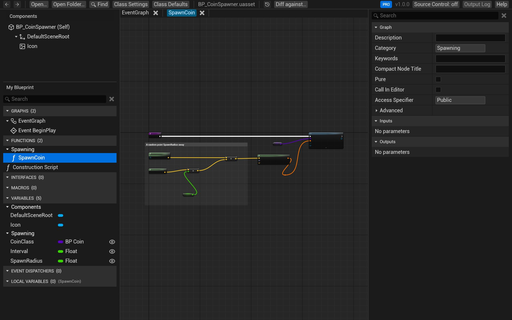
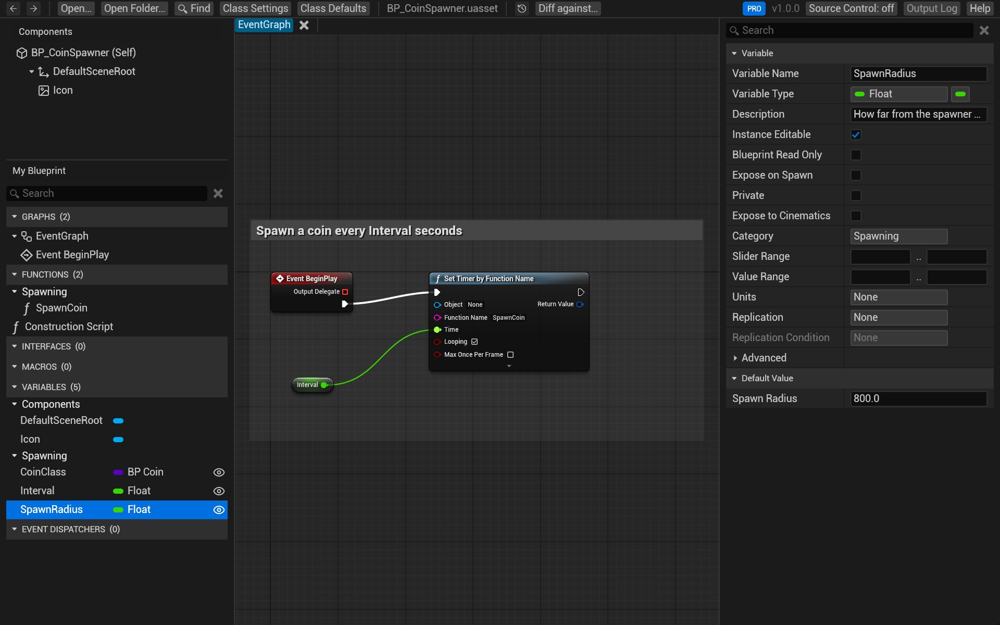
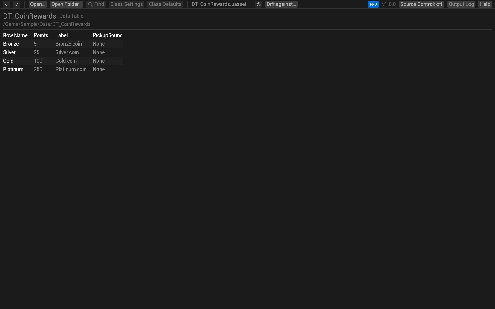
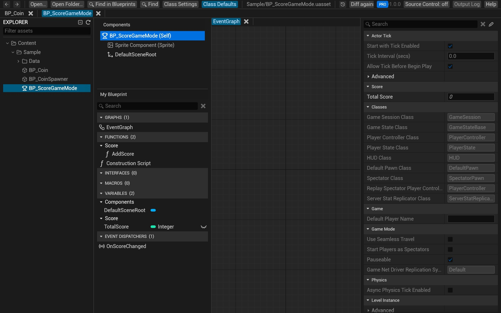

# Open and browse Blueprints

Open one asset, or a whole project's `Content` folder, and read it as in the Blueprint editor: the graphs in the
middle, *Components* and *My Blueprint* on the left, *Details* on the right. Nothing can be changed.

## Open one asset

Any of these opens a `.uasset`:

- **Open…** at the top left (or on the empty window), then pick the file.
- Drag the file onto the window.
- In Explorer, right-click the file and choose *Open with → BlueprintReview*.

BlueprintReview opens Blueprints, and user-defined enums, structs and data tables. A Blueprint's event graph opens
in a tab; other graphs open in tabs of their own when you double-click them in *My Blueprint*.

### Find your way around a graph

| To | Do |
|---|---|
| Pan | Drag with the right mouse button, or with the left button on a node |
| Zoom | Mouse wheel. Hold <kbd>Ctrl</kbd> to zoom in past 1:1, as in the editor |
| Fit the graph to the window | <kbd>F</kbd> or <kbd>Home</kbd>, with the pointer over the graph |
| Select nodes | Click; <kbd>Shift</kbd>+click adds, <kbd>Ctrl</kbd>+click toggles; drag on empty space draws a box |
| Open what a node calls | Double-click it: a function call opens the function, a macro its graph, a collapsed node its graph |
| Open a state machine, state or transition rule | Double-click it in an Animation Blueprint: its graph opens in the same tab, and the path above the graph (*AnimGraph › Locomotion › Idle to Walk (rule)*) goes back up. Hover a transition to read its rule |
| Show advanced pins | Click the arrow at the bottom of the node; click it again to hide them |
| Go back | <kbd>Alt</kbd>+<kbd>Left</kbd>, the back mouse button, or the ← arrow at the top left |

## The panels

- **Components** lists the components, as a tree: the ones a C++ parent class adds (a Character's capsule, mesh
  and movement component), then the Blueprint's own. Click one to see its properties in *Details*. The top row,
  *(Self)*, shows the class defaults. Components from your project's own C++ classes aren't listed yet: see
  [Troubleshooting](troubleshooting.md#components-from-a-c-parent-class-are-missing).
- **My Blueprint** lists the graphs, functions, macros, variables and event dispatchers, by category. Click a
  variable or function to see it in *Details*; double-click a graph or function to open it. While a function's
  tab is shown, *Local Variables* at the bottom lists that function's local variables.
- **Details** shows what's selected: a variable's type, flags and default, a function's inputs and outputs, or a
  component's properties. A node shows what the editor shows for it: a variable get or set its variable, a
  function's entry or a custom event its signature, other nodes nothing. To see a node's class, GUID, pins and saved
  properties too, turn on **Developer Settings** → *Show node internals in Details* in the version label's menu at
  the top right.
- **Class Defaults** and **Class Settings** at the top show the Blueprint's defaults (with the values it inherits,
  dimmed) and its class settings (parent class, interfaces, options).

In *Class Defaults*, the pencil button next to the search box shows only the properties the Blueprint changes.

## Enums, structs and data tables

These open as a table: an enum's entries, a struct's fields with their types and defaults, or a data table's rows,
one column per field.

## Open a whole project

1. Click **Open Folder…** and pick the project's `Content` folder (or any folder of assets), or drag the folder
   onto the window.
2. The **Explorer** on the left lists every asset, as folders. Type in **Filter assets** to narrow it.
3. Click an asset to open it. Each opens in a tab at the top; click a tab to go back to it.

With a folder open, BlueprintReview also finds what one asset uses in another:

- Double-click a call to a function of another Blueprint (a parent class, a game mode, a function library) and
  that Blueprint opens at the function.
- A Blueprint's parent classes, enums and structs are read from the folder, so inherited defaults and enum names
  show.
- **Find in Blueprints** searches every asset in it: see [Search](search.md).

<kbd>Ctrl</kbd>+<kbd>Shift</kbd>+<kbd>E</kbd> shows or hides the Explorer.

## Larger or smaller text

<kbd>Ctrl</kbd>+<kbd>=</kbd> and <kbd>Ctrl</kbd>+<kbd>-</kbd> make everything larger or smaller, and
<kbd>Ctrl</kbd>+<kbd>0</kbd> resets it; <kbd>Ctrl</kbd>+scroll over the panels does the same. Click the version
number at the top right for the same buttons. The scale is kept for next time.

## Try it on the sample

1. Click **Open Folder…** and pick `sample-project/Content`.
2. In the Explorer, open `Sample`, then click **BP_CoinSpawner**.
3. In *My Blueprint*, double-click **SpawnCoin**: the function opens in a tab.
4. Click **SpawnRadius** under *Variables*: *Details* shows it is a Float, instance editable, in the *Spawning*
   category, with a default of 800.
5. Click **BP_Coin** in the Explorer, then double-click the **Score Coin** node in its event graph: the
   `ScoreCoin` function opens. Press <kbd>Alt</kbd>+<kbd>Left</kbd> to go back.

## Related

- [Search](search.md) a Blueprint or a project.
- [Copy nodes](copy-nodes.md) into the editor.
- [Keyboard and mouse](shortcuts.md): every shortcut.
