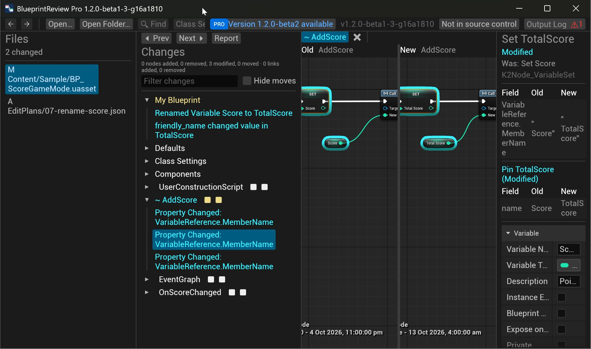
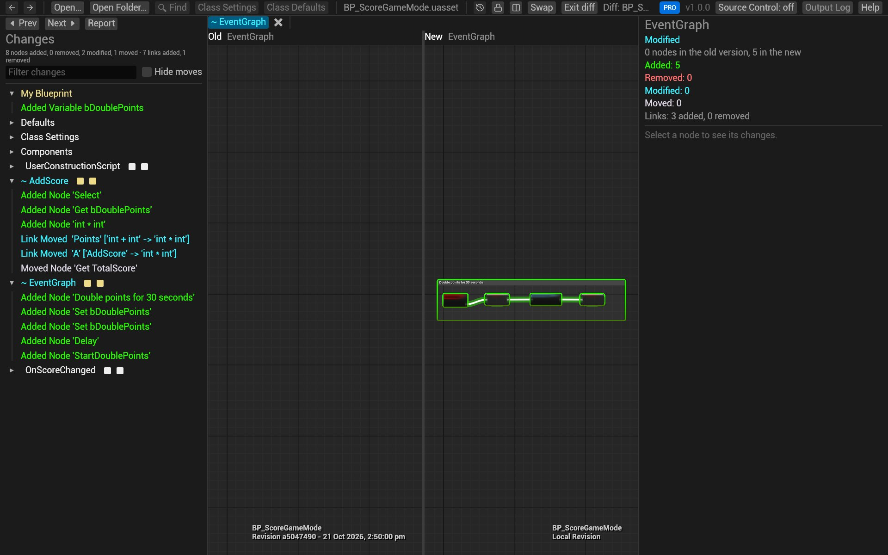
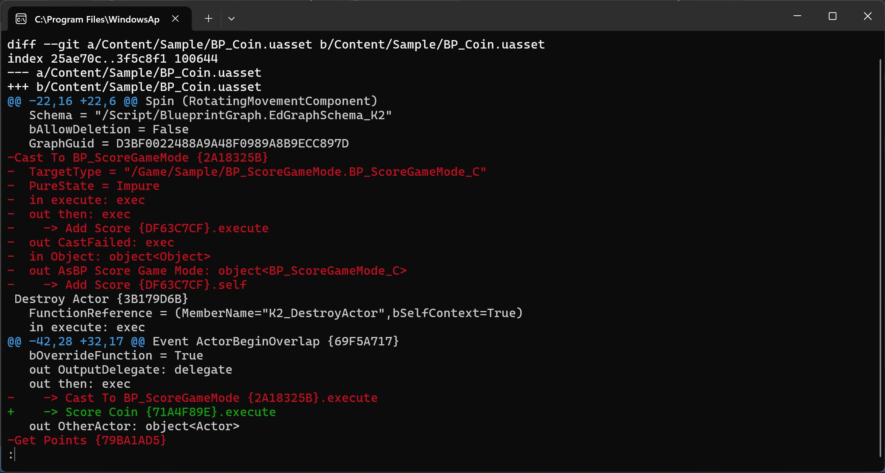

# Review changes in git

Make git show Blueprints properly: `git difftool` opens BlueprintReview's side-by-side diff, and `git diff`,
`git log -p` and `git show` print what changed in a Blueprint as text, instead of `Binary files differ`. Git LFS
works as usual.

## Set it up once

1. Install BlueprintReview (the installer puts `blueprintreview` on your `PATH`), [Git](https://git-scm.com/), and
   [Git LFS](https://git-lfs.com/) if your project uses it.
2. For your account, in any terminal:

   ```sh
   blueprintreview git-setup --global
   ```

   This adds BlueprintReview as a difftool named `blueprintreview`, and as the text driver for Blueprints.
3. In each project repository, once:

   ```sh
   blueprintreview git-setup
   git add .gitattributes
   git commit -m "Show Blueprints in git diff"
   ```

   This adds `*.uasset diff=blueprintreview` to `.gitattributes`. Once it's committed, teammates only need step 2.

`--dry-run` on either command prints what would change and changes nothing.

## Review your uncommitted changes

```sh
git difftool -y -t blueprintreview -- Content/Characters/BP_Hero.uasset
```

opens the file as it is now against the last committed version. Leave the path out to step through every changed
asset in turn (`-y` skips git's question before each). Each side is labelled with where it comes from:
`Revision 4d46d5f… - <date>` for a commit, `Local Revision` for your working copy.

## Review a commit

```sh
git difftool -d -y -t blueprintreview HEAD~1 HEAD
```

`-d` opens one window for the whole commit: a **Files** panel on the left lists every Blueprint it changed, marked
`M` (modified), `A` (added) or `D` (deleted). Click one to see its diff. Replace `HEAD~1 HEAD` with any two
commits, tags or branches.



## Compare a branch with main

```sh
git difftool -d -y -t blueprintreview main...feature/double-points
```

The three dots compare the branch with where it left `main`, so you see only the branch's own changes, as a pull
request does.



## Read changes as text

After the setup, the usual commands describe Blueprints in words, one fact per line:

```sh
git diff -- Content/Sample/BP_Coin.uasset
git log -p -3 -- Content/Sample
git show HEAD
```

```diff
 Event ActorBeginOverlap {69F5A717}
   bOverrideFunction = True
   out OutputDelegate: delegate
   out then: exec
-    -> Cast To BP_ScoreGameMode {2A18325B}.execute
+    -> Score Coin {71A4F89E}.execute
   out OtherActor: object<Actor>
```

Each node is listed with its properties and pins, and each wire once, on the pin it leaves (`->`). The braces hold
the start of the node's GUID, to tell two nodes of the same name apart.

This is handy for a quick look, `git log -S`, and code review tools that only show text. Node positions are left
out, so moving nodes shows no change.



## Try it on the sample

In the sample's folder (after [getting it](get-the-sample.md)):

1. `git log --oneline` lists the commits.
2. Review the commit that renamed the score variable:

   ```sh
   git difftool -d -y -t blueprintreview "HEAD~7" "HEAD~6"
   ```

   *Files* lists `BP_ScoreGameMode` alone; its *Changes* show *Renamed Variable Score to TotalScore* and the three
   nodes that follow it.
3. Compare the branch: `git difftool -d -y -t blueprintreview main...feature/double-points`. `AddScore` gains a
   *bDoublePoints* check, and the event graph a *StartDoublePoints* event.
4. `git log -p -2 -- Content/Sample/BP_ScoreGameMode.uasset` prints the last two changes as text.

## Troubleshooting

- **The diff shows a "Git LFS pointer":** the file wasn't downloaded. Run `git lfs pull`.
- **git asks which tool to use, or opens another one:** pass `-t blueprintreview`, or make it the default with
  `git config --global diff.tool blueprintreview`.
- **`git diff` still says `Binary files differ`:** the repository's `.gitattributes` lacks the line; run
  `blueprintreview git-setup` in it.

## Related

- [Compare two versions](compare.md): reading the diff view.
- [Time-lapse](timelapse.md): an asset's history, step by step.
- [Review pull requests](review-prs.md) on GitHub.
