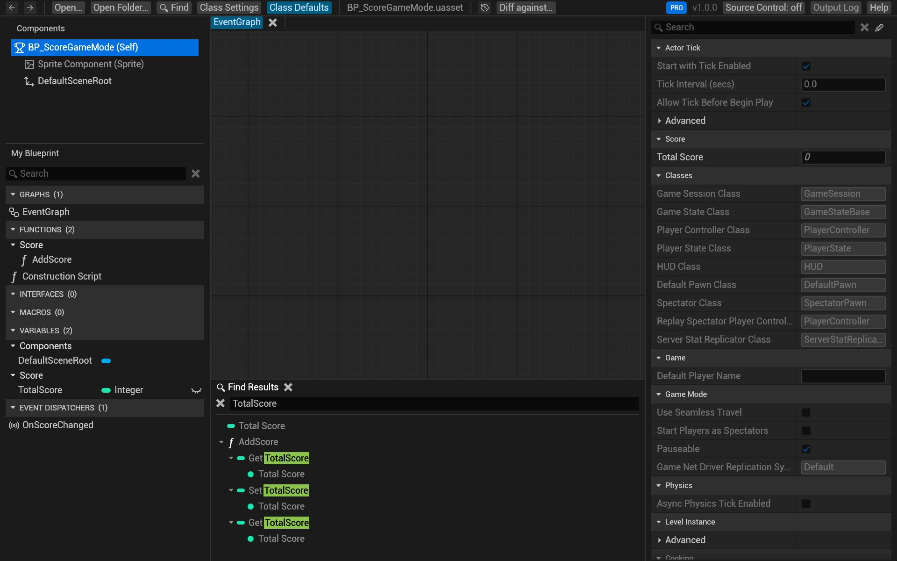
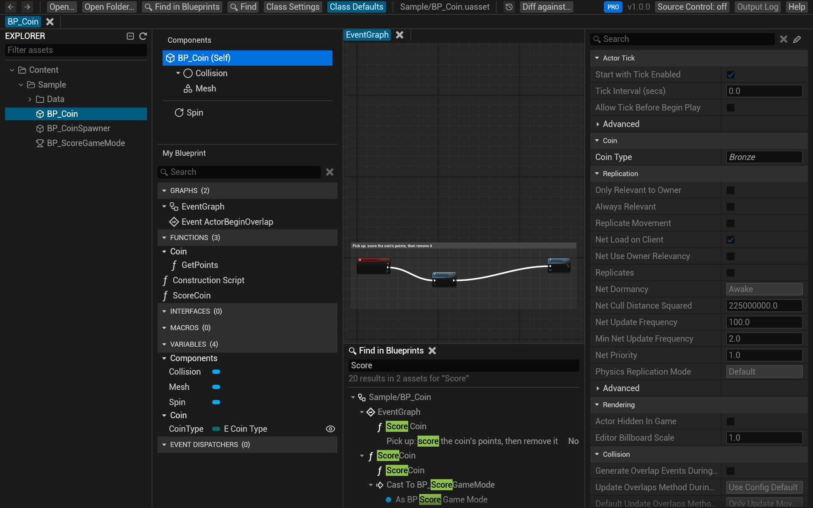

# Search

Find where a variable, function, event or node is used: in the open Blueprint with **Find**, or in every Blueprint
of a folder with **Find in Blueprints**. Both search what the editor's searches do: node titles, pin names and
default values, comments, variables, functions, components and their types, inside collapsed graphs, state
machines, states and transition rules too.

## Search the open Blueprint

1. Press <kbd>Ctrl</kbd>+<kbd>F</kbd>, or click **Find** at the top left. The *Find Results* panel opens at the
   bottom, with its search box focused.
2. Type what you're looking for and press <kbd>Enter</kbd>.
3. The results are a tree: graph, then node, then the pin or value that matched. Click the arrows to open and
   close it.
4. Double-click a result to jump to it: its graph opens and the node is selected and framed.

To find where something in *My Blueprint* is used (a variable, a function, an event, a component), right-click it
and choose **Find References**: *Find Results* lists the nodes that use it, under their graphs. On the graph,
right-click a variable's get or set node for the same (a local variable's, an inherited one's or another class's
too). It finds that member only, not everything whose name contains its name: *Health* doesn't find *MaxHealth*.
Pressing <kbd>Enter</kbd> in the search box afterwards searches for the text instead.

## Search every Blueprint in a folder

With a folder open ([Open and browse](open-and-browse.md#open-a-whole-project)):

1. Press <kbd>Ctrl</kbd>+<kbd>Shift</kbd>+<kbd>F</kbd>, or click **Find in Blueprints** at the top left.
2. Type and press <kbd>Enter</kbd>. The results are grouped by asset; the first ones show while the rest of the
   folder is still being searched.
3. Double-click a result to open its asset at that node.

The folder is read once when you open it, in the background, so even large projects answer in well under a second.

## How a query matches

- Case doesn't matter, and spaces in names are ignored: `spawnradius` finds *Spawn Radius*.
- A word matches any part of a name: `Score` finds *TotalScore*, *AddScore* and *OnScoreChanged*.
- Several words must all match the same item: `Set Score` finds *Set TotalScore* nodes.
- Quotes keep words together as one phrase: `"Set TotalScore"`.

## Try it on the sample

1. Open `Content/Sample/BP_ScoreGameMode.uasset`.
2. Press <kbd>Ctrl</kbd>+<kbd>F</kbd>, type `TotalScore` and press <kbd>Enter</kbd>: the results list the
   variable and the nodes in *AddScore* that get and set it.
3. Open the sample's `Content` folder instead, press <kbd>Ctrl</kbd>+<kbd>Shift</kbd>+<kbd>F</kbd> and search
   `Score`: the results include `BP_Coin`'s *ScoreCoin* function, which calls `AddScore` in the game mode.

## Related

- [Open and browse](open-and-browse.md)
- [Keyboard and mouse](shortcuts.md)
