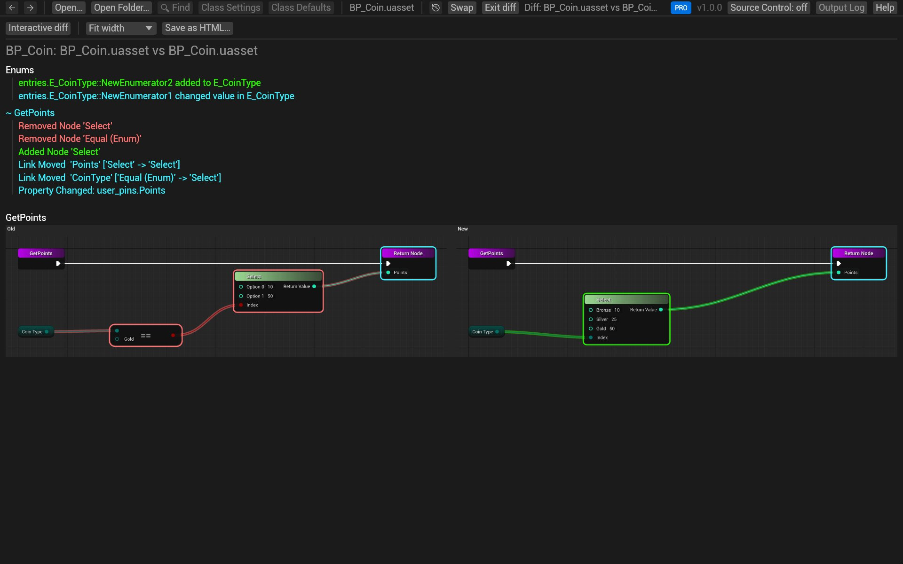

# Share a diff

Send a Blueprint change to someone who doesn't have BlueprintReview: as one HTML page, as images, or as text for a
ticket or chat.

## As an HTML page

1. Open the diff ([Compare two versions](compare.md), or from [git](review-git.md) or [P4V](review-perforce.md)).
2. Click **Report** above *Changes*. The report lists every change, then shows each changed graph's old and new
   versions side by side.
3. Click **Save as HTML…** and choose where to save it.

The file holds everything, images included, and opens in any browser. It works in Lite too.



## As images

`blueprintreview render` writes each graph as an SVG image. With `--against`, it writes the changed graphs only,
old and new side by side, with the changes highlighted:

```sh
blueprintreview render Content/Sample/BP_Coin.uasset --against old/BP_Coin.uasset -o coin-diff
```

`coin-diff/` then holds an `.svg` per changed graph, which browsers, chat apps and most wikis show.

## As text

`blueprintreview diff` prints the change list as Markdown, for a ticket, a pull request description or chat:

```sh
blueprintreview diff old/BP_Coin.uasset Content/Sample/BP_Coin.uasset > coin-diff.md
```

`--format json` gives the same as JSON, for scripts. `--exit-code` makes it exit with 1 when something other than moves changed,
for CI.

> **Pro:** `blueprintreview diff` and `render` are part of Pro (and the trial).

## Copy nodes

To show someone the nodes themselves, [copy them](copy-nodes.md) and paste into
[blueprintue.com](https://blueprintue.com), which gives you a link to share.

## Try it on the sample

1. Open the change from the "Silver coins" commit: in the sample's folder,

   ```sh
   git difftool -y -t blueprintreview "HEAD~11" "HEAD~10" -- Content/Sample/BP_Coin.uasset
   ```

2. Click **Report**, then **Save as HTML…**, and open the file in your browser.

## Related

- [Compare two versions](compare.md)
- [Command line](../CLI.md): every option of `diff` and `render`.
