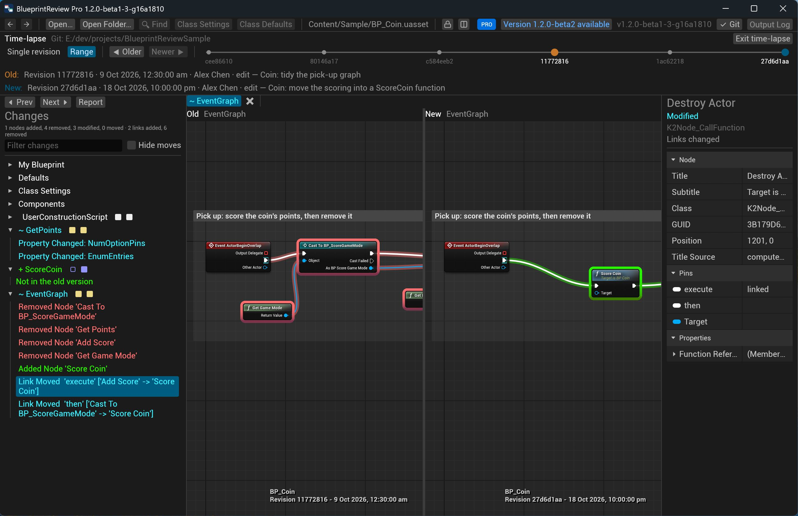

# Time-lapse: an asset's history

Step through every revision of an asset and see what each one changed, as P4V's *Time-lapse View* does for text
files. It works with git and Perforce.

> **Pro:** Time-lapse is part of Pro (and the trial). In Lite the History button shows a *PRO* mark.

## Before you start

- The asset must be in a git work tree, or a Perforce workspace the app can reach
  ([Connect the app to Perforce](review-perforce.md#connect-the-app-to-perforce)). The source control button at the
  top right says `✔ Git` or `✔ Perforce` when it is.
- `git` (Git for Windows) or `p4` (P4V's installer) on your `PATH`.

## Steps

1. Open the asset from your work tree or workspace (not a copy elsewhere).
2. Click **History**, the clock button next to *Diff against…*. A bar appears under the toolbar with a tick for each
   revision, oldest on the left; your uncommitted changes, if any, are the last tick, *Local*.
3. Click a tick. The diff view shows that revision against the one before it: what that commit or changelist did.
   Hover a tick for its date, author and description.
4. Step with **◀ Older** and **Newer ▶**, or <kbd>Left</kbd> and <kbd>Right</kbd> with the pointer over the bar.
   The graph you have open stays open as you step.
5. To compare any two revisions, switch to **Range**: drag the orange (old) and blue (new) handles.
6. **Exit time-lapse** takes you back to your working copy.

Under the bar, *Old:* and *New:* say which revisions are shown, with their message. Revisions are fetched in the
background and kept, so stepping back is instant. The first revision is shown against nothing, so everything in it
is added.

With git, the history follows the file through renames, on the main line of merges only (like a Perforce file
log). With Perforce, it follows moves and branches.

## Try it on the sample

1. Open `sample-project/Content/Sample/BP_Coin.uasset` (from the clone, so the app finds git).
2. Click **History**. The bar has six ticks: the commits that changed the coin.
3. Click the second tick, *Coin: Silver coins…*: in `GetPoints`, the *Equal (Enum)* check for Gold is gone, and a
   Select on the coin type picks the points.
4. Press **Newer ▶**: the spin commit. *Changes* lists the *Spin* component, and *Collision* and *Mesh* changed.
5. Press **Newer ▶** again: the tidy commit, which only moved nodes. Tick **Hide moves** and *Changes* is empty.

## Related

- [Compare two versions](compare.md): reading the diff view.
- [Review changes in git](review-git.md) and [in Perforce](review-perforce.md).
