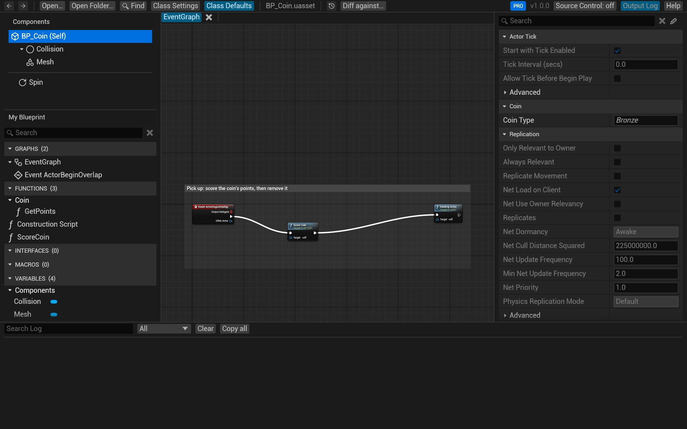
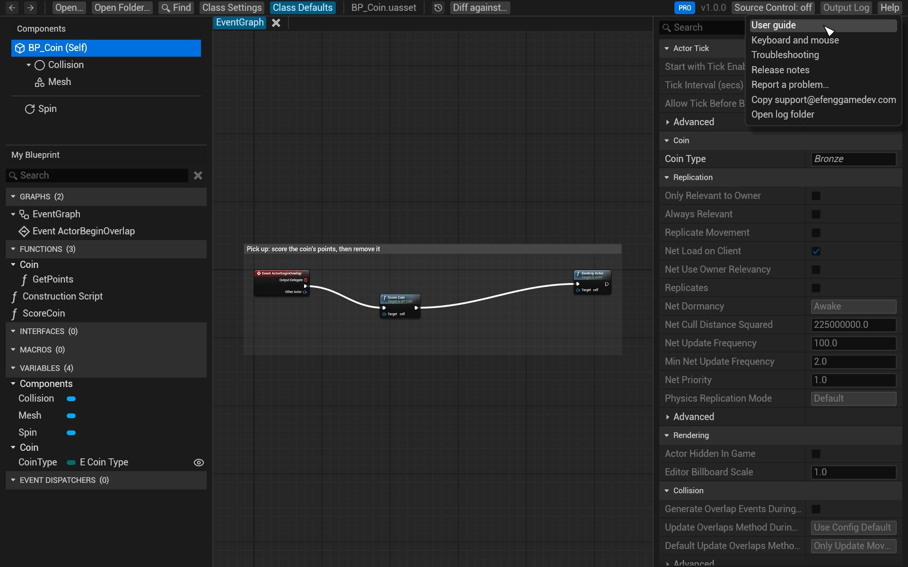

# Troubleshooting

## A file won't open

| The message says | What to do |
|---|---|
| *a cooked asset* | The file comes from a packaged build, and cooking removes the graphs. Open the asset from the project's `Content` folder instead |
| *a Git LFS pointer, not the asset* | The real file hasn't been downloaded. Run `git lfs pull` in the repository |
| *a StaticMesh asset, not a Blueprint* (or another kind) | BlueprintReview opens Blueprints, enums, structs and data tables. Other assets (meshes, materials, maps) have no graphs to show |
| *saved by an engine older than UE 4.25* | Re-save the asset in a newer editor |
| *unsupported package* | The asset was saved in a form BlueprintReview doesn't read yet. Please send it to us, with the engine version |

Widget Blueprints and Animation Blueprints open, with their event graphs and functions, and an Animation
Blueprint's AnimGraph, state machines and transition rules. A Widget Blueprint's Designer isn't shown.

## Enum values show as NewEnumerator0

The Blueprint stores only an enum's entry names; their display names are in the enum's own asset. Open the
Blueprint from inside its project (or open the project's `Content` folder) so BlueprintReview finds the enum. When
it can't, a ⚠ in the toolbar lists what's missing; dropping the enum's `.uasset` onto the window fills it in.

## Inherited values are missing

A Blueprint's parent Blueprint holds the values it inherits. Open the folder the Blueprints are in, or drop the
parent's `.uasset` onto the window. A note in *Class Defaults* says when the parent wasn't found.

## Components from a C++ parent class are missing

BlueprintReview knows what the Unreal Engine's own C++ classes add, from a copy of the stock UE 5.8 classes that
ships with it, not from your project. So, for now:

- **A Blueprint based on your project's own C++ class** (or a plugin's) lists only the components the Blueprint
  adds, not the ones the C++ class creates, nor the ones it inherits from an engine class such as `Character`. A
  component of yours attached to one of them shows under its name alone.
- **A modified engine:** the components and inherited values shown are the stock engine's. What your engine changes
  (a component added, removed or attached elsewhere, a different default) doesn't show.
- **Another engine version:** the list is UE 5.8's, which is usually the same as your engine's.

The same goes for the inherited values in *Class Defaults* and in a C++ component's *Details*: those come from
the stock engine classes too. Open the Blueprint in the Unreal editor to see them as your project has them.

Node titles have the same limit: a node calling a function of your project's own C++ shows the function's name
made readable (*Conv String to Model Part Guid*), not the display name the C++ gives it, and its pins are the ones
the asset saved. Functions of the engine and of the plugins that ship with it show as in the editor.

## A Blueprint looks wrong

1. Click **Output Log** at the top right (or press <kbd>Ctrl</kbd>+<kbd>`</kbd>). It lists warnings for the open
   file: nodes it couldn't fully read, assets it couldn't find.
2. If something still looks different from the editor, write to us: see below.

## git difftool or P4V doesn't open BlueprintReview

- git: see [Review changes in git, Troubleshooting](review-git.md#troubleshooting).
- P4V: see [Review changes in Perforce, Troubleshooting](review-perforce.md#troubleshooting).

## The app doesn't start, or crashes

If BlueprintReview crashes, a dialog says so and names its log. The logs are in
`%LOCALAPPDATA%\BlueprintReview\Logs`: `BlueprintReview.log` for the current run, the five before it as backups.
Starting BlueprintReview again moves the crashed run's log to the newest `BlueprintReview-backup-*.log`.

If one file trips over a bug, that file shows *ran into an internal error* instead of opening, and the rest of the
app goes on: please send that file.

## Report a problem

**Help → Report a problem…** at the top right starts an email to
[support@efenggamedev.com](mailto:support@efenggamedev.com) in your mail app, with your version in the subject and
the version, system and log folder in the message. With webmail, **Help → Copy support@efenggamedev.com** copies
the address instead. Please attach:

- `BlueprintReview.log` (**Help → Open log folder**);
- the `.uasset` that shows the problem, if you can share it, and the engine version that saved it;
- a screenshot, if something looks wrong.

